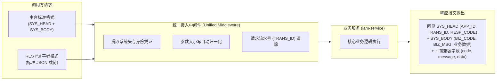
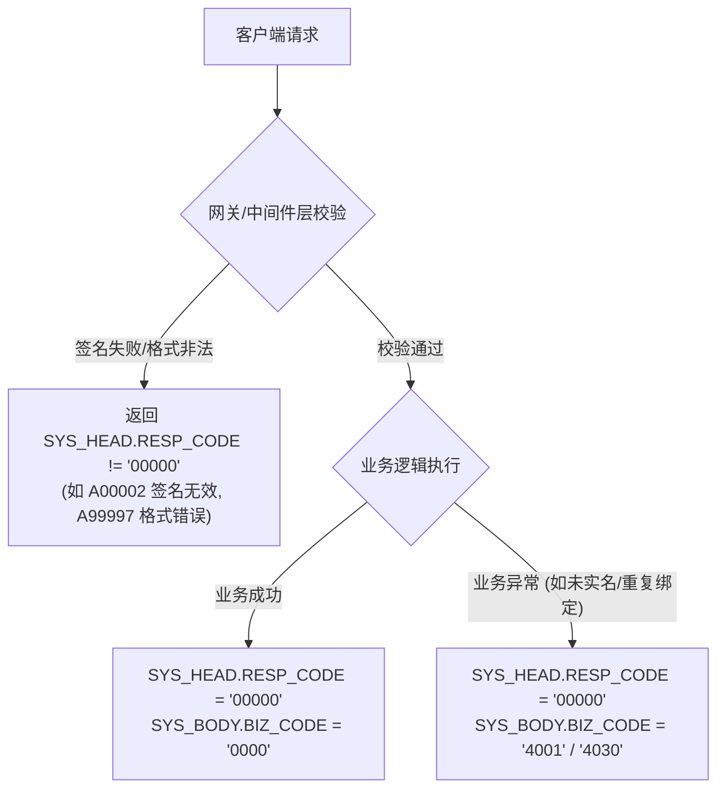

# 国家中试基地与数智中台 · 通信协议与认证鉴权规范

本文档规定了国家工业中试基地与数智中台各业务系统在实时交互（REST/JSON）与网关通信过程中的**通信机制**、**统一报文封装**、**三级鉴权机制**及**异常分层处理标准**。

---

## 1. 通信机制与协议说明

### 1.1 基本网络与编码规约
- **通信协议**：统一采用 **HTTP / HTTPS 1.1 / 2.0**，生产环境强制启用 **TLS 1.2 / TLS 1.3** 加密传输。
- **数据组织格式**：统一采用 **JSON**（RFC 8259 标准）。所有字符集编码必须统一为 **UTF-8**。
- **HTTP 传输谓词**：能力开放接口原则上采用 `POST` 方法（查询类轻量接口可兼容 `GET`）。
- **REST 调用地址规范**：
  ```
  https://{host}:{port}/api/{API名称}/{版本号}
  或内部微服务规范：
  http://{host}:{port}/api/v1/{业务模块}/{动作}
  ```
- **超时约束标准**：
  - **连接超时 (Connect Timeout)**：默认 $\le$ 5000ms；
  - **读取超时 (Read Timeout)**：默认 $\le$ 15000ms（涉及复杂计算或报表导出的特殊接口可放宽至 30000ms）。

### 1.2 HTTP 请求头标准（HTTP Headers）

| 消息头名称 | 必填 | 规范取值 | 说明 |
| :--- | :---: | :--- | :--- |
| `Content-Type` | 是 | `application/json; charset=UTF-8` | 规定报文传输格式与字符集编码 |
| `Accept` | 是 | `application/json` | 客户端期望接收的响应格式 |
| `Authorization` | 视场景 | `Bearer <JWT_TOKEN>` | 访问需要租户上下文的内部微服务时必填 |
| `Accept-Encoding` | 否 | `gzip` | 客户端支持的数据压缩格式 |

---

## 2. 报文结构与协议封装

为了兼顾**国家中试基地统一部署规范**与**敏捷微服务开发**，平台全面支持**双模报文协议适配**：
1. **中台统一封装模式**：包含 `SYS_HEAD`（系统头）、`SYS_BODY`（业务体）、`SYS_ATTACHED`（附加信息）。
2. **标准 RESTful 平铺模式**：便于前后端直接对接，由系统中间件自动进行上下文对齐与报文回显。



### 2.1 请求报文结构标准

```json
{
  "SYS_HEAD": {
    "APP_ID": "APP_SZ_PILOT_001",
    "TIMESTAMP": "2026-11-17 14:00:00 128",
    "TRANS_ID": "20261117140000128952701",
    "TOKEN": "3bf481a5e78345fa2cd2fbf495dc8981",
    "RESERVED": []
  },
  "SYS_BODY": {
    "_【API名称】_REQ": {
      "【业务参数Key】": "【业务参数Value】"
    }
  },
  "SYS_ATTACHED": {
    "MEDIA_INFO": ""
  }
}
```

#### 请求系统参数说明（SYS_HEAD）

| 字段名称 | 类型 | 必填 | 规范格式与约束 | 说明 |
| :--- | :--- | :---: | :--- | :--- |
| `APP_ID` | `varchar(32)` | Y | 如 `APP_SZ_PILOT_001` | 平台分配的应用接入标识码 |
| `TIMESTAMP` | `timestamp` | Y | 格式 `yyyy-MM-dd HH:mm:ss SSS` | 发起调用的系统毫秒时间戳 |
| `TRANS_ID` | `char(32)` | Y | 格式 `yyyyMMddHHmmssSSS + 6位随机数` | 全局唯一调用流水号（长23位） |
| `TOKEN` | `varchar(32)` | Y | 32位小写 MD5 Hex | 访问令牌（按统一算法生成） |
| `RESERVED` | `array` | N | `[{"RESERVED_ID": "", "RESERVED_VALUE": ""}]` | 扩展系统级透传属性数组 |

### 2.2 响应报文结构标准

```json
{
  "SYS_HEAD": {
    "APP_ID": "APP_SZ_PILOT_001",
    "TIMESTAMP": "2026-11-17 14:00:00 256",
    "TRANS_ID": "20261117140000128952701",
    "RESP_CODE": "00000",
    "RESP_DESC": "Success",
    "RESERVED": []
  },
  "SYS_BODY": {
    "_【API名称】_RSP": {
      "BIZ_CODE": "0000",
      "BIZ_MSG": "操作成功",
      "【业务字段Key】": "【业务字段Value】"
    }
  },
  "SYS_ATTACHED": {
    "MEDIA_INFO": ""
  },
  "code": 200,
  "message": "success",
  "data": { ... }
}
```

#### 响应系统参数说明（SYS_HEAD）

| 字段名称 | 类型 | 说明 | 规范约定 |
| :--- | :--- | :--- | :--- |
| `APP_ID` | `varchar(32)` | 接入标识码 | 必须严格回显请求报文中的 `APP_ID` |
| `TIMESTAMP` | `timestamp` | 响应时间戳 | 格式 `yyyy-MM-dd HH:mm:ss SSS` |
| `TRANS_ID` | `char(32)` | 全局流水号 | 必须严格回显请求报文中的 `TRANS_ID`，用于链路追踪 |
| `RESP_CODE`| `varchar(6)` | 平台/网关返回码 | `00000` 表示平台级调用成功；非 `00000` 详见错误码表 |
| `RESP_DESC`| `varchar(128)`| 返回描述 | 如 `Success` 或具体的系统级拦截原因 |
| `RESERVED` | `array` | 扩展属性 | 回显或传递扩展系统级属性 |

---

## 3. 认证鉴权机制体系

系统依据调用场景不同，采用三级正交鉴权防护体系：
1. **中台开放能力鉴权**：用于各子平台、外部机构通过统一 API 网关调用 OpenAPI，基于 **MD5 签名令牌 (TOKEN)**；
2. **服务内部会话鉴权**：用于前端组件、iframe 嵌入页面及微服务间通信，基于 **标准 JWT (JSON Web Token)**；
3. **网关穿透染色鉴权**：用于 API 网关校验通过后，向下游子平台透传经过验签的安全上下文，基于 **HMAC-SHA256 签名头**。

### 3.1 国家中试基地统一 TOKEN 算法

#### 计算步骤
1. **提取与 ASCII 升序排序**：
   提取请求 `SYS_HEAD` 中除 `TOKEN` 本身以外的所有系统参数名（当前包含 `APP_ID`、`TIMESTAMP`、`TRANS_ID`），按字典 ASCII 升序排列；
2. **键值拼接**：
   依次将参数名与参数值拼接：
   $$\text{raw\_str} = \text{key}_1 + \text{val}_1 + \text{key}_2 + \text{val}_2 + \dots$$
3. **末尾拼加密钥**：
   将平台分配的 `APP_SECRET` 直接追加至末尾：
   $$\text{sign\_source} = \text{raw\_str} + \text{APP\_SECRET}$$
4. **MD5 摘要生成**：
   对上述待加密源串执行 MD5 计算，取 **32位小写 16 进制字符串**：
   $$\text{TOKEN} = \text{md5}(\text{sign\_source}).\text{lower}()$$

#### 演算示例
- `APP_ID` = `APP_SZ_PILOT_001`
- `TIMESTAMP` = `2026-11-17 14:00:00 128`
- `TRANS_ID` = `20261117140000128952701`
- `APP_SECRET` = `B2732427`

1. 升序排序键：`APP_ID`, `TIMESTAMP`, `TRANS_ID`
2. 键值拼接后源串：
   `APP_IDAPP_SZ_PILOT_001TIMESTAMP2026-11-17 14:00:00 128TRANS_ID20261117140000128952701`
3. 拼入 Secret：
   `APP_IDAPP_SZ_PILOT_001TIMESTAMP2026-11-17 14:00:00 128TRANS_ID20261117140000128952701B2732427`
4. MD5 计算结果：
   `57d603a52f7867f94a68c478e79d07ba`

#### Python 3 参考实现
```python
import hashlib

def generate_pilot_token(app_id: str, timestamp: str, trans_id: str, app_secret: str) -> str:
    params = {
        "APP_ID": app_id,
        "TIMESTAMP": timestamp,
        "TRANS_ID": trans_id,
    }
    # 1. 按照 ASCII 字典升序排序参数名
    sorted_keys = sorted(params.keys())
    # 2. 依次拼接 key + value
    raw_str = "".join(f"{k}{params[k]}" for k in sorted_keys)
    # 3. 末尾拼入 secret
    raw_str += app_secret
    # 4. MD5 32 位小写 Hex 计算
    return hashlib.md5(raw_str.encode("utf-8")).hexdigest().lower()
```

#### Java 参考实现
```java
import java.security.MessageDigest;
import java.util.Map;
import java.util.TreeMap;

public class PilotTokenUtil {
    public static String generateToken(String appId, String timestamp, String transId, String appSecret) throws Exception {
        Map<String, String> map = new TreeMap<>();
        map.put("APP_ID", appId);
        map.put("TIMESTAMP", timestamp);
        map.put("TRANS_ID", transId);

        StringBuilder sb = new StringBuilder();
        for (Map.Entry<String, String> entry : map.entrySet()) {
            sb.append(entry.getKey()).append(entry.getValue());
        }
        sb.append(appSecret);

        MessageDigest md = MessageDigest.getInstance("MD5");
        byte[] bytes = md.digest(sb.toString().getBytes("UTF-8"));
        StringBuilder hex = new StringBuilder();
        for (byte b : bytes) {
            hex.append(String.format("%02x", b));
        }
        return hex.toString();
    }
}
```

---

### 3.2 内部服务会话 JWT 格式规范

用于前端 `8001/ui/*` 页面与后端微服务鉴权，请求时需在 HTTP 头携带：
```http
Authorization: Bearer <token>
```
JWT Payload Claims 结构包含：
```json
{
  "sub": "usr_9a8b7c6d",
  "user_id": "usr_9a8b7c6d",
  "tenant_id": "ten_88880001",
  "portal_user_id": "p_1001",
  "account_type": "MASTER",
  "role_code": "TENANT_ADMIN",
  "workspace_id": "ws_default_001",
  "iat": 1794894000,
  "exp": 1794980400
}
```

---

### 3.3 网关 9 大可信 Header 染色与签名规范

API 网关在鉴权通过后，向下游子平台发起转发请求时，剥离外部可能伪造的头信息，注入经过 HMAC-SHA256 签名的 9 大可信头：

| 请求头字段 | 类型 | 说明与示例 |
| :--- | :--- | :--- |
| `X-Portal-Tenant-Id` | `string` | 当前租户 ID（如 `ten_88880001`） |
| `X-Portal-User-Id` | `string` | 当前发起操作的用户 ID（如 `usr_sub_101`） |
| `X-Portal-Master-Uid`| `string` | 归属的主账号 ID，用于计费扣费归集（如 `usr_root_001`） |
| `X-Portal-Workspace-Id`| `string`| 目标工作空间 ID（如 `ws_default_001`） |
| `X-Portal-Role-Code` | `string` | 用户在当前空间的角色（如 `TENANT_DEVELOPER`） |
| `X-Shadow-Account` | `string` | 异构系统影子账号 ID（如无为空字符串） |
| `X-Gateway-Timestamp`| `string` | 网关签名时间戳秒数（如 `1794894309`） |
| `X-Gateway-Nonce` | `string` | 16 位随机防重放字符串 |
| `X-Gateway-Signature`| `string` | 基于 `GATEWAY_HMAC_SECRET` 计算的十六进制签名 |

#### 签名计算规则
将上述前 8 个头按字母升序键拼接后进行 `HMAC-SHA256` 计算：
$$\text{Signature} = \text{HMAC\_SHA256}(\text{SortedHeaderPayload}, \text{GATEWAY\_HMAC\_SECRET})$$

下游子平台收到请求后，若时间戳偏差超过 $\pm 300$ 秒，或签名不匹配，立即返回 `HTTP 403 Forbidden`。

---

## 4. 统一应答码与异常分层规范

遵循国家中试基地与数智中台规范，实行**双层返回码机制**：
1. **网关/系统层返回码 (`RESP_CODE`)**：反映服务路由、签名鉴权、网络寻址状态；
2. **业务逻辑层返回码 (`BIZ_CODE`)**：反映业务办理成功与否或业务规则校验细节。



> [!IMPORTANT]
> 规范 2.4.4 明确规定：只要请求成功到达业务端并有业务层返回结果（无论业务办理是成功还是失败），响应报文头中的 `RESP_CODE` 统一表示为 `00000`；只有在网关拦截、签名未通过或网络协议层出现异常时，`RESP_CODE` 才输出对应的系统异常代码（如 `A00002`、`A99997`）。
