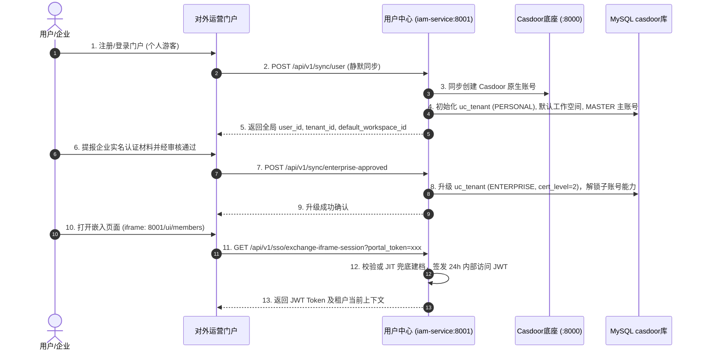

# 模块一：门户同步与单点登录（SSO）接口规范

本文档详述对外运营服务门户与用户与权限中心（`iam-service`）之间的用户状态同步、企业实名升级、前端 iframe 免密会话置换、企业子账号门户登录兜底及标准 OIDC 认证接口。

---

## 1. 业务全景与交互时序



---

## 2. 接口列表清单

| 接口名称 | HTTP Method | 接口路由 | 鉴权方式 | 详细功能说明 |
| :--- | :---: | :--- | :--- | :--- |
| **门户用户静默同步** | `POST` | `/api/v1/sync/user` | 中台 TOKEN / 免密 | 门户注册/登录时双写建档，具有天然幂等性 |
| **企业认证通过回调** | `POST` | `/api/v1/sync/enterprise-approved`| 中台 TOKEN / 免密 | 门户审核通过企业实名后升级租户与解锁子账号 |
| **子账号审核通过同步** | `POST` | `/api/v1/sync/sub-account` | 中台 TOKEN / 免密 | 门户子账号申请通过后同步至权限中心与 Casdoor（幂等） |
| **iframe 免密换票** | `GET` | `/api/v1/sso/exchange-iframe-session`| Portal Token | 供嵌入页面加载时置换内部 JWT 会话凭据 |
| **子账号登录兜底** | `POST` | `/api/v1/sso/sub-login` | 账号密码 | 门户在本地查无账号时，交由本服务向 Casdoor 验密 |
| **OIDC 凭证换取/刷新**| `POST` | `/api/v1/sso/oauth/token` | Basic / Client Secret | 标准 OAuth 2.0 授权码换 Token 与 Refresh Token |

---

## 3. 接口详细定义

### 3.1 门户注册/登录静默双写同步 (`POST /api/v1/sync/user`)

#### 业务说明
当用户在门户完成手机号注册或登录时，门户后台异步或同步调用此接口。
- **首次调用（新用户）**：自动在 Casdoor 创建用户，在 `uc_tenant` 创建个人租户（`PERSONAL`，`cert_level=0`），在 `perm_tenant_workspace` 创建默认工作空间（`ws_default_{portal_uid}`），在 `uc_user_profile` 创建主账号（`account_type="MASTER"`），并在 `perm_user_role_workspace` 分配管理员角色；
- **后续调用（老用户）**：保持强幂等性，不重复建号，直接返回已关联的全局实体 ID。

#### 请求参数

**Path & Method**: `POST /api/v1/sync/user`  
**Headers**: `Content-Type: application/json`

**Body 字段定义**:
| 字段名 | 类型 | 必填 | 默认值 | 示例值 | 说明 |
| :--- | :--- | :---: | :---: | :--- | :--- |
| `portal_user_id` | `string` | 是 | 无 | `"p_9001"` | 门户系统中的用户物理标识 |
| `username` | `string` | 是 | 无 | `"zhangsan_ceo"` | 登录用户名 |
| `display_name` | `string` | 是 | 无 | `"张三"` | 用户姓名或显示名称 |
| `phone` | `string` | 否 | `null` | `"13800138000"` | 手机号 |
| `email` | `string` | 否 | `null` | `"zhangsan@sz.ai"` | 邮箱 |
| `is_platform_admin` | `boolean` | 否 | `false` | `false` | 是否为数智底座超级平台管理员 |
| `is_enterprise` | `boolean` | 否 | `false` | `false` | 是否注册即为企业用户（若为 true 初始化为企业租户） |
| `company_name` | `string` | 否 | `""` | `"苏州数智科技有限公司"` | 企业名称（若为企业用户必填） |

#### 请求报文示例（双模兼容）`

**1. 中台统一报文模式**：
```json
{
  "SYS_HEAD": {
    "APP_ID": "APP_SZ_PILOT_001",
    "TIMESTAMP": "2026-11-17 14:10:00 128",
    "TRANS_ID": "20261117141000128000111",
    "TOKEN": "57d603a52f7867f94a68c478e79d07ba",
    "RESERVED": []
  },
  "SYS_BODY": {
    "_SYNC_USER_REQ": {
      "PORTAL_USER_ID": "p_9001",
      "USERNAME": "zhangsan_ceo",
      "DISPLAY_NAME": "张三",
      "PHONE": "13800138000",
      "IS_ENTERPRISE": false
    }
  },
  "SYS_ATTACHED": {
    "MEDIA_INFO": ""
  }
}
```

**2. 标准 RESTful 平铺模式**：
```json
{
  "portal_user_id": "p_9001",
  "username": "zhangsan_ceo",
  "display_name": "张三",
  "phone": "13800138000",
  "is_enterprise": false
}
```

#### 响应报文示例
```json
{
  "SYS_HEAD": {
    "APP_ID": "APP_SZ_PILOT_001",
    "TIMESTAMP": "2026-11-17 14:10:00 256",
    "TRANS_ID": "20261117141000128000111",
    "RESP_CODE": "00000",
    "RESP_DESC": "Success",
    "RESERVED": []
  },
  "SYS_BODY": {
    "_PORTAL_USER_SYNC_RSP": {
      "BIZ_CODE": "0000",
      "BIZ_MSG": "success",
      "user_id": "usr_p_9001",
      "tenant_id": "ten_p_9001",
      "tenant_type": "PERSONAL",
      "default_workspace_id": "ws_default_p_9001",
      "is_new_user": true
    }
  },
  "SYS_ATTACHED": {
    "MEDIA_INFO": ""
  },
  "code": 200,
  "message": "success",
  "data": {
    "user_id": "usr_p_9001",
    "tenant_id": "ten_p_9001",
    "tenant_type": "PERSONAL",
    "default_workspace_id": "ws_default_p_9001",
    "is_new_user": true
  }
}
```

---

### 3.2 门户后台企业认证通过回调 (`POST /api/v1/sync/enterprise-approved`)

#### 业务说明
当企业在门户提交营业执照、法人信息等工商资料并经后台运营专家审核通过后，门户调用本接口触发租户升级。
- 租户类型升级为 `ENTERPRISE`；
- 实名等级提升至 `cert_level = 2`，状态变更为 `cert_status = 2`；
- 更新统一社会信用代码与法定代表人姓名；
- **解锁创建多级企业子账号树权限**。

#### 请求参数
**Path & Method**: `POST /api/v1/sync/enterprise-approved`  
**Headers**: `Content-Type: application/json`

| 字段名 | 类型 | 必填 | 示例值 | 说明 |
| :--- | :--- | :---: | :--- | :--- |
| `portal_user_id` | `string` | 是 | `"p_9001"` | 申请认证的门户用户标识 |
| `company_name` | `string` | 是 | `"昆山数字智能科技有限公司"` | 企业工商全称 |
| `credit_code` | `string` | 是 | `"91320583MA27XXXXXX"` | 18 位统一社会信用代码 |
| `legal_person_name` | `string` | 是 | `"张三"` | 法定代表人姓名 |

#### 响应报文示例
```json
{
  "code": 200,
  "message": "success",
  "data": {
    "tenant_id": "ten_p_9001",
    "tenant_type": "ENTERPRISE",
    "tenant_name": "昆山数字智能科技有限公司",
    "cert_level": 2,
    "cert_status": 2
  }
}
```

---

### 3.2.1 门户子账号申请审核通过同步 (`POST /api/v1/sync/sub-account`)

#### 业务说明
当门户侧发起企业子账号申请并审核通过后，由门户后台回调本接口同步子账号信息（用户中心前端页面不再提供直接新建子账号入口）：
- 通过 `master_portal_user_id` 或 `tenant_id` 定位所属已实名企业租户；
- 按 `portal_user_id` 实现强幂等：重复回调不会重复建号，直接返回已有子账号档案；
- 自动写入物化路径树（`uc_user_profile`）并同步至 Casdoor，同时绑定初始工作空间与角色（未指定工作空间时默认授权至企业默认主空间）；
- 同步完成后，企业主账号/管理员可在用户中心页面对该子账号的角色、模块白名单、工作空间及状态进行调整。

#### 请求参数
**Path & Method**: `POST /api/v1/sync/sub-account`  
**Headers**: `Content-Type: application/json`

| 字段名 | 类型 | 必填 | 默认值 | 示例值 | 说明 |
| :--- | :--- | :---: | :---: | :--- | :--- |
| `portal_user_id` | `string` | 是 | 无 | `"p_sub_9001_01"` | 门户系统该子账号的用户 ID（幂等键与 SSO 映射键） |
| `master_portal_user_id` | `string` | 条件必填 | `""` | `"p_9001"` | 所属企业主账号在门户的用户 ID（与 `tenant_id` 二选一） |
| `tenant_id` | `string` | 条件必填 | `""` | `"ten_p_9001"` | 所属企业租户 ID（与 `master_portal_user_id` 二选一） |
| `parent_portal_user_id` | `string` | 否 | `""` | `""` | 直接上级门户用户 ID（选填，不传默认挂在主账号下） |
| `username` | `string` | 是 | 无 | `"li_dev_01"` | 子账号登录名 |
| `display_name` | `string` | 是 | 无 | `"李工"` | 员工姓名 / 显示名 |
| `phone` | `string` | 否 | `null` | `"13900001111"` | 手机号 |
| `email` | `string` | 否 | `null` | `"li@sz.ai"` | 邮箱 |
| `password` | `string` | 否 | `null` | `null` | 初始密码（门户管理密码时可不传） |
| `workspace_ids` | `string[]` | 否 | `null` | `["ws_default_p_9001"]` | 初始授权工作空间列表（不传默认授权企业默认空间） |
| `role_code` | `string` | 否 | `"TENANT_DEVELOPER"` | `"TENANT_DEVELOPER"` | 初始标准角色：`TENANT_ADMIN` / `TENANT_DEVELOPER` / `TENANT_FINANCE` / `TENANT_VIEWER` |
| `allowed_modules` | `string[]` | 否 | `["*"]` | `["platform:model_engine:module:*"]` | 研发模块准入白名单 |
| `status` | `int` | 否 | `1` | `1` | 账号状态：`1-正常`，`2-冻结` |

#### 请求报文示例
```json
{
  "portal_user_id": "p_sub_9001_01",
  "master_portal_user_id": "p_9001",
  "username": "li_dev_01",
  "display_name": "李工",
  "phone": "13900001111",
  "role_code": "TENANT_DEVELOPER"
}
```

#### 响应报文示例
```json
{
  "code": 200,
  "message": "success",
  "data": {
    "user_id": "usr_sub_p_sub_9001_01",
    "portal_user_id": "p_sub_9001_01",
    "username": "li_dev_01",
    "display_name": "李工",
    "tenant_id": "ten_p_9001",
    "account_type": "SUB",
    "parent_user_id": "usr_p_9001",
    "tree_path": "/usr_p_9001/usr_sub_p_sub_9001_01/",
    "depth_level": 2,
    "workspaces": ["ws_default_p_9001"],
    "role_code": "TENANT_DEVELOPER",
    "allowed_modules": ["*"],
    "status": 1,
    "is_new_user": true
  }
}
```

---

### 3.3 iframe 嵌入页面免密换票 (`GET /api/v1/sso/exchange-iframe-session`)

#### 业务说明
供 `8001/ui/*`（成员与角色管理、工作空间管理、API Key 管理）在作为 iframe 嵌入到门户中打开时自动发起调用。
1. 前端获取 URL 参数中的 `portal_token` 并传给后端；
2. 后端反查门户用户信息（若配置 `PORTAL_USERINFO_URL`）或执行本地安全解析；
3. **执行 JIT 懒加载建档**：若此用户尚未在 `iam-service` 建档，自动完成建号与租户初始化；
4. 签发有效期为 24 小时的内部访问 JWT Token，支持无感单点登录。

#### 请求参数
**Path & Method**: `GET /api/v1/sso/exchange-iframe-session`  
**Query Parameters**:
| 参数名 | 类型 | 必填 | 示例值 | 说明 |
| :--- | :--- | :---: | :--- | :--- |
| `portal_token` | `string` | 是 | `"token_p_9002_jit_user"` | 门户颁发给当前用户的登录 Token |

#### 响应报文示例
```json
{
  "code": 200,
  "message": "success",
  "data": {
    "token": "eyJhbGciOiJIUzI1NiIsInR5cCI6IkpXVCJ9...",
    "user_id": "usr_p_9002",
    "tenant_id": "ten_p_9002",
    "tenant_type": "PERSONAL",
    "default_workspace_id": "ws_default_p_9002",
    "role_code": "TENANT_ADMIN",
    "expires_in": 86400
  }
}
```

---

### 3.4 企业子账号登录门户兜底接口 (`POST /api/v1/sso/sub-login`)

#### 业务说明
由于企业主账号创建的子账号直接在 Casdoor 和 `iam-service` 中建档，存量门户本地数据库暂无子账号记录。本接口专用于门户登录接口的“兜底验证通道”：
1. 当用户在门户输入账号密码登录时，门户优先查本地库；
2. 若本地无此账号，门户将凭证通过本接口转发给 `iam-service`；
3. `iam-service` 请求 Casdoor 校验密码哈希；
4. 校验通过后，返回子账号所属的租户 ID、企业名称、账号主子类型 (`account_type="SUB"`)、标准角色列表及空间 ID，门户据此建立登录态。

#### 请求参数
**Path & Method**: `POST /api/v1/sso/sub-login`  
**Headers**: `Content-Type: application/json`

| 字段名 | 类型 | 必填 | 示例值 | 说明 |
| :--- | :--- | :---: | :--- | :--- |
| `username` | `string` | 是 | `"algo_expert_alice"` | 子账号登录用户名 |
| `password` | `string` | 是 | `"Password123!@#"` | 登录密码 |

#### 响应报文示例
```json
{
  "code": 200,
  "message": "success",
  "data": {
    "user_id": "usr_sub_422356f6",
    "tenant_id": "ten_p_9001",
    "tenant_name": "昆山数字智能科技有限公司",
    "account_type": "SUB",
    "roles": ["TENANT_DEVELOPER"],
    "default_workspace_id": "ws_default_p_9001"
  }
}
```

---

### 3.5 OIDC 标准认证与凭证换取规范 (`POST /api/v1/sso/oauth/token`)

#### 业务说明
系统完全遵循 **RFC 6749** 与 **OpenID Connect Core 1.0** 标准，由 Casdoor 原生引擎提供端到端 OAuth 2.0 授权码核销服务。

#### 请求参数
**Path & Method**: `POST /api/v1/sso/oauth/token`  
**Headers**:
- `Content-Type: application/x-www-form-urlencoded`
- `Authorization: Basic base64(client_id:client_secret)`（可选）

**Body 字段**:
| 参数名 | 物理类型 | 必填 | 说明 |
| :--- | :--- | :---: | :--- |
| `grant_type` | `string` | 是 | 固定值：`authorization_code` 或 `refresh_token` |
| `client_id` | `string` | 是 | 在 Casdoor 注册的应用 Client ID |
| `client_secret` | `string` | 是 | 应用 Client Secret |
| `code` | `string` | 条件 | 授权码（`grant_type=authorization_code` 时必填） |
| `redirect_uri` | `string` | 条件 | 回调 URI，必须与发起授权请求时完全一致 |
| `refresh_token` | `string` | 条件 | 刷新令牌（`grant_type=refresh_token` 时必填） |

#### 响应报文示例
```json
{
  "access_token": "eyJhbGciOiJSUzI1NiIsImtpZCI6...",
  "token_type": "Bearer",
  "expires_in": 7200,
  "refresh_token": "rt_8a9b0c1d2e3f4a5b6c7d",
  "id_token": "eyJhbGciOiJSUzI1NiIs...",
  "scope": "openid profile email"
}
```
