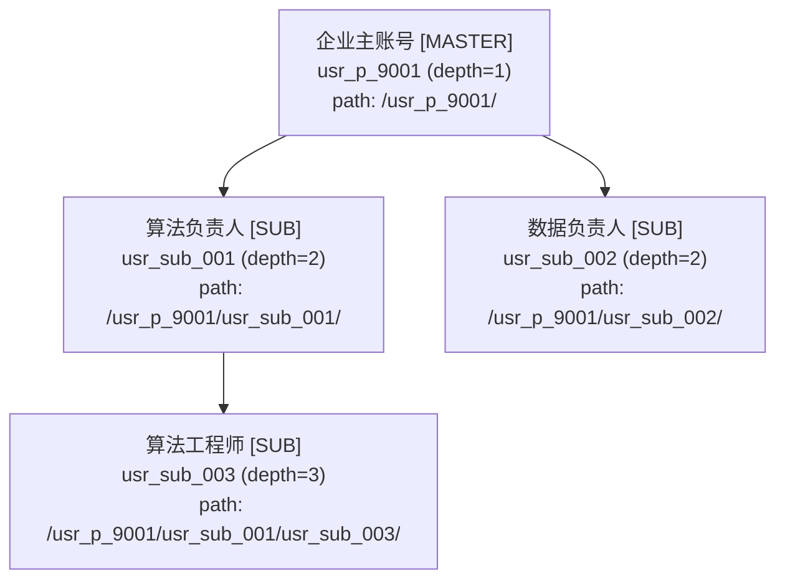

# 模块二：企业主子账号树管理接口规范

本文档规范数智底座企业租户内部主子账号树的创建、授权绑定与层级拓扑查询接口。

---

## 1. 架构原理与物化路径设计

### 1.1 主子账号关系与物化路径（Materialized Path）
在企业复杂组织架构中，为支持高效的层级遍历、越权检测与计费话单归集，系统采用**物化路径模式**维护企业组织树：
- **主账号（Master Account）**：物理路径根节点，路径为 `/{master_user_id}/`，层级深度 `depth_level = 1`。所有子账号产生的算力、模型、API 消费话单（CDR）均向上归集至主账号；
- **二级子账号（Sub-Account Level 2）**：如算法总监，路径为 `/{master_user_id}/{sub_user_id_1}/`，层级深度 `depth_level = 2`；
- **三级子账号（Sub-Account Level 3）**：如算法工程师，路径为 `/{master_user_id}/{sub_user_id_1}/{sub_user_id_2}/`，层级深度 `depth_level = 3`。



### 1.2 权限范围约束定律
- **子账号范围收敛**：子账号可操作的工作空间集合与权限角色必须严格受限于其所属企业租户所拥有的资源范围：
  $$\text{SubAccountScope} \subseteq \text{MasterAccountScope}$$
- **前置认证门槛**：**只有完成企业实名认证**（`tenant_type == "ENTERPRISE"` 且 `cert_level >= 2`）的租户，企业管理员才有权创建子账号。个人租户（`PERSONAL`）不可派生子账号。

---

## 2. 接口列表清单

| 接口名称 | HTTP Method | 接口路由 | 鉴权方式 | 说明 |
| :--- | :---: | :--- | :--- | :--- |
| **创建企业子账号** | `POST` | `/api/v1/uc/sub-account/create` | JWT / 角色校验 | 校验企业实名状态，生成物化路径，同步 Casdoor 并授权 |
| **查询企业主子树** | `GET` | `/api/v1/uc/sub-account/tree` | JWT (租户内) | 按层级升序输出当前企业下所有主子账号结构树 |

---

## 3. 接口详细定义

### 3.1 创建企业子账号 (`POST /api/v1/uc/sub-account/create`)

#### 前置校验规则
1. 当前操作人必须登录并具备 `TENANT_ADMIN` 或 `PLATFORM_ADMIN` 角色；
2. 操作人所属租户必须为 `ENTERPRISE` 且 `cert_level >= 2`（若未认证，返回 `HTTP 403 Forbidden`）；
3. 检查登录名 `username` 全局唯一性；
4. 若指定了 `parent_user_id`，校验上级账号必须属于本企业租户。

#### 请求参数
**Path & Method**: `POST /api/v1/uc/sub-account/create`  
**Headers**:
- `Content-Type: application/json`
- `Authorization: Bearer <JWT_TOKEN>`

| 字段名 | 类型 | 必填 | 默认值 | 示例值 | 说明 |
| :--- | :--- | :---: | :---: | :--- | :--- |
| `username` | `string` | 是 | 无 | `"algo_expert_alice"` | 子账号登录用户名 |
| `password` | `string` | 是 | 无 | `"Password123!@#"` | 初始登录密码 |
| `display_name` | `string` | 是 | 无 | `"爱丽丝(算法专家)"` | 员工真实姓名/显示名称 |
| `phone` | `string` | 否 | `null` | `"13900139001"` | 手机号 |
| `email` | `string` | 否 | `null` | `"alice@company.com"`| 邮箱 |
| `parent_user_id`| `string` | 否 | `""` | `""` | 直接上级用户 ID；为空时默认挂在主账号下 |
| `workspace_ids` | `array[string]`| 是 | 无 | `["ws_default_001"]`| 允许加入的工作空间 ID 列表 |
| `role_code` | `string` | 是 | 无 | `"TENANT_DEVELOPER"`| 租户标准角色（4选1，见数据字典） |
| `allowed_modules`| `array[string]`| 否 | `[]` | `["platform:model_engine:module:*"]` | 针对研发角色的平台大模块准入白名单 |

#### 请求报文示例
```json
{
  "username": "algo_expert_alice",
  "password": "Password123!@#",
  "display_name": "爱丽丝(算法专家)",
  "phone": "13900139001",
  "parent_user_id": "",
  "workspace_ids": ["ws_default_p_9001"],
  "role_code": "TENANT_DEVELOPER",
  "allowed_modules": [
    "platform:model_engine:module:*"
  ]
}
```

#### 响应报文示例
```json
{
  "code": 200,
  "message": "success",
  "data": {
    "user_id": "usr_sub_422356f6",
    "username": "algo_expert_alice",
    "display_name": "爱丽丝(算法专家)",
    "tenant_id": "ten_p_9001",
    "account_type": "SUB",
    "parent_user_id": "usr_p_9001",
    "tree_path": "/usr_p_9001/usr_sub_422356f6/",
    "depth_level": 2,
    "workspaces": ["ws_default_p_9001"],
    "role_code": "TENANT_DEVELOPER",
    "allowed_modules": [
      "platform:model_engine:module:*"
    ]
  }
}
```

---

### 3.2 查询企业主子账号树列表 (`GET /api/v1/uc/sub-account/tree`)

#### 业务说明
查询当前登录用户所属企业租户下的全量子账号树结构。按 `depth_level` 升序与创建顺序排列，返回每个账号关联的所属工作空间、角色和模块白名单，前端页面可通过 `tree_path` 方便地组装为树形树状控件。

#### 请求参数
**Path & Method**: `GET /api/v1/uc/sub-account/tree`  
**Headers**:
- `Authorization: Bearer <JWT_TOKEN>`

#### 响应报文示例
```json
{
  "code": 200,
  "message": "success",
  "data": [
    {
      "user_id": "usr_p_9001",
      "username": "zhangsan_ceo",
      "display_name": "张三(法人代表)",
      "phone": "13800138000",
      "account_type": "MASTER",
      "parent_user_id": "",
      "tree_path": "/usr_p_9001/",
      "depth_level": 1,
      "status": 1,
      "workspaces": ["ws_default_p_9001"],
      "roles": ["TENANT_ADMIN"],
      "allowed_modules": ["*"]
    },
    {
      "user_id": "usr_sub_422356f6",
      "username": "algo_expert_alice",
      "display_name": "爱丽丝(算法专家)",
      "phone": "13900139001",
      "account_type": "SUB",
      "parent_user_id": "usr_p_9001",
      "tree_path": "/usr_p_9001/usr_sub_422356f6/",
      "depth_level": 2,
      "status": 1,
      "workspaces": ["ws_default_p_9001"],
      "roles": ["TENANT_DEVELOPER"],
      "allowed_modules": ["platform:model_engine:module:*"]
    },
    {
      "user_id": "usr_sub_0b0bb15d",
      "username": "data_engineer_bob",
      "display_name": "鲍勃(数据分析师)",
      "phone": null,
      "account_type": "SUB",
      "parent_user_id": "usr_sub_422356f6",
      "tree_path": "/usr_p_9001/usr_sub_422356f6/usr_sub_0b0bb15d/",
      "depth_level": 3,
      "status": 1,
      "workspaces": ["ws_default_p_9001"],
      "roles": ["TENANT_DEVELOPER"],
      "allowed_modules": ["platform:caict_data:module:*"]
    }
  ]
}
```
