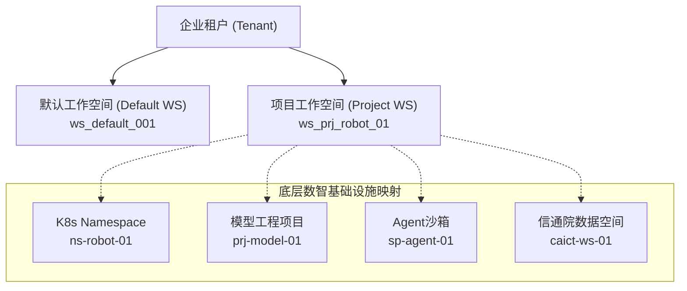

# 模块三：工作空间与角色权限接口规范

本文档详述多租户工作空间（Workspace）生命周期管理、7 大标准业务角色分配及细粒度平台大模块（Module Scope）准入白名单裁剪接口。

---

## 1. 架构定位与资源拓扑

### 1.1 租户工作空间（Workspace）概念
工作空间是数智底座中租户开展研发与资源隔离的最高生产单元：
- 租户注册时系统自动生成一个**默认工作空间**（`is_default = 1`）；
- 租户可依据业务项目自主开辟多个**项目工作空间**（`is_default = 0`）；
- 一个工作空间向下直接映射为底层计算基础设施的命名空间或沙箱目录：
  - **算力调度平台**：映射为独立的 Kubernetes Namespace（`k8s_namespace`）；
  - **模型工程平台**：映射为算法项目空间（`model_project_id`）；
  - **Agent 编排平台**：映射为智能体沙箱空间（`agent_space_id`）；
  - **信通院数据工程**：映射为数据处理工程空间（`caict_workspace_id`）。



### 1.2 全网 7 大标准角色体系

系统统一定义全网仅有的 7 大标准业务角色（Role Code），任何子平台严禁自行增设孤立自定义角色：

| 分类 | 角色代码 (Role Code) | 角色中文名称 | 权限范围与职责定义 |
| :---: | :--- | :--- | :--- |
| **平台侧** | `PLATFORM_ADMIN` | 平台超级管理员 | 系统全局配置、跨租户策略维护、底层异构算力池与集群运维（不参与业务生产） |
| **平台侧** | `PLATFORM_OPERATOR` | 平台运营与中试专家 | 企业实名审核、商品上下架审批、中试五阶段专家评审与报告签发 |
| **平台侧** | `PLATFORM_DEMO` | 平台全通演示专家 | 售前顾问、展厅讲解、验收人员使用，拥有全业务操作权，享有**网关免计费穿透白名单** |
| **租户侧** | `TENANT_ADMIN` | 租户主管理员 | 租户内最高管理权（空间管理、商品订阅、API Key 轮换、子账号创建），继承研发与财务权限 |
| **租户侧** | `TENANT_DEVELOPER`| 租户研发工程师 | **全平台研发操作中枢**（模型微调、Agent编排、算力申领、信通院数据标注），配合模块开关裁剪 |
| **租户侧** | `TENANT_FINANCE` | 租户财务商务专员 | 充值对账、账单明细查询、话单 CDR 导出、订单契约签署与查阅 |
| **租户侧** | `TENANT_VIEWER` | 租户只读观察员 | 访客体验试用，或企业高管只读查看看板与质检报告 |

### 1.3 平台大模块准入白名单裁剪机制
针对 `TENANT_DEVELOPER`（租户研发工程师），通过 `allowed_modules` 配置平台模块前缀，实现无需新增繁复定制角色即可精细管控权限：
- 全部放行：`["*"]`
- 仅放行模型工程平台：`["platform:model_engine:module:*"]`
- 仅放行算力调度平台：`["platform:compute:module:*"]`
- 仅放行 Agent 工程平台：`["platform:agent:module:*"]`
- 仅放信念数据工程：`["platform:caict_data:module:*"]`

---

## 2. 接口列表清单

| 接口名称 | HTTP Method | 接口路由 | 鉴权方式 | 说明 |
| :--- | :---: | :--- | :--- | :--- |
| **新建工作空间** | `POST` | `/api/v1/perm/workspace/create` | JWT (`TENANT_ADMIN`) | 创建项目空间并绑定底层基础设施 |
| **工作空间列表** | `GET` | `/api/v1/perm/workspace/list` | JWT (租户内) | 查询当前租户下所有活跃工作空间 |
| **查询角色与模块白名单**| `GET` | `/api/v1/perm/user/modules-and-roles` | JWT (用户上下文) | 查询用户在指定空间/平台的角色与模块白名单（Redis优先） |

---

## 3. 接口详细定义

### 3.1 新建租户工作空间 (`POST /api/v1/perm/workspace/create`)

#### 请求参数
**Path & Method**: `POST /api/v1/perm/workspace/create`  
**Headers**:
- `Content-Type: application/json`
- `Authorization: Bearer <JWT_TOKEN>`

| 字段名 | 类型 | 必填 | 默认值 | 示例值 | 说明 |
| :--- | :--- | :---: | :---: | :--- | :--- |
| `workspace_name` | `string` | 是 | 无 | `"具身智能联合创新空间"` | 工作空间显示名称 |
| `k8s_namespace` | `string` | 否 | 自动生成 | `"ns-embodied-ai"` | 映射底层算力平台 K8s Namespace |
| `model_project_id`| `string` | 否 | `""` | `"prj_model_9901"` | 映射模型工程项目标识 |
| `agent_space_id` | `string` | 否 | `""` | `"sp_agent_9901"` | 映射 Agent 平台沙箱标识 |
| `caict_workspace_id`| `string`| 否 | `""` | `"caict_ws_9901"` | 映射信通院数据工程标识 |
| `quota_config_json`| `object` | 否 | `{}` | `{"cpu":"16C","memory":"64G","gpu":"2xV100"}` | 空间配额配置 |

#### 请求报文示例
```json
{
  "workspace_name": "具身智能联合创新空间",
  "k8s_namespace": "ns-embodied-ai",
  "model_project_id": "prj_model_9901",
  "quota_config_json": {
    "cpu": "16C",
    "memory": "64G",
    "gpu": "2xV100"
  }
}
```

#### 响应报文示例
```json
{
  "code": 200,
  "message": "success",
  "data": {
    "workspace_id": "ws_prj_42834a92",
    "tenant_id": "ten_p_9001",
    "workspace_name": "具身智能联合创新空间",
    "is_default": false,
    "k8s_namespace": "ns-embodied-ai",
    "model_project_id": "prj_model_9901",
    "agent_space_id": "",
    "caict_workspace_id": "",
    "quota_config_json": {
      "cpu": "16C",
      "memory": "64G",
      "gpu": "2xV100"
    },
    "status": 1
  }
}
```

---

### 3.2 查询当前租户工作空间列表 (`GET /api/v1/perm/workspace/list`)

#### 请求参数
**Path & Method**: `GET /api/v1/perm/workspace/list`  
**Headers**:
- `Authorization: Bearer <JWT_TOKEN>`

#### 响应报文示例
```json
{
  "code": 200,
  "message": "success",
  "data": [
    {
      "workspace_id": "ws_default_p_9001",
      "tenant_id": "ten_p_9001",
      "workspace_name": "默认工作空间",
      "is_default": true,
      "k8s_namespace": "ns-p_9001",
      "model_project_id": "",
      "agent_space_id": "",
      "caict_workspace_id": "",
      "quota_config_json": {
        "cpu": "8C",
        "memory": "32G",
        "storage": "100G"
      },
      "status": 1
    },
    {
      "workspace_id": "ws_prj_42834a92",
      "tenant_id": "ten_p_9001",
      "workspace_name": "具身智能联合创新空间",
      "is_default": false,
      "k8s_namespace": "ns-embodied-ai",
      "model_project_id": "prj_model_9901",
      "agent_space_id": "",
      "caict_workspace_id": "",
      "quota_config_json": {
        "cpu": "16C",
        "memory": "64G",
        "gpu": "2xV100"
      },
      "status": 1
    }
  ]
}
```

---

### 3.3 查询用户在指定空间/平台的角色与模块白名单 (`GET /api/v1/perm/user/modules-and-roles`)

#### 业务说明
供各业务子平台（如模型工程、算力调度）在渲染前端菜单或拦截具体操作权限时调用。
- **高速缓存架构**：优先从 Redis 查询缓存（Key: `perm:user:{tenant_id}:{user_id}:{ws_id}:{platform_code}`，TTL 600s）；
- **模块白名单裁剪**：自动根据传入的 `platform_code` 裁剪过滤出属于该目标平台的模块项（如 `platform:model_engine:*`）。

#### 请求参数
**Path & Method**: `GET /api/v1/perm/user/modules-and-roles`  
**Headers**:
- `Authorization: Bearer <JWT_TOKEN>`

**Query Parameters**:
| 参数名 | 类型 | 必填 | 示例值 | 说明 |
| :--- | :--- | :---: | :--- | :--- |
| `platform_code` | `string` | 是 | `"MODEL_ENGINE"` | 目标子平台代码（如 `MODEL_ENGINE`, `COMPUTE`, `AGENT`, `CAICT_DATA_ENG`） |
| `workspace_id` | `string` | 是 | `"ws_default_p_9001"` | 工作空间标识 |

#### 响应报文示例
```json
{
  "code": 200,
  "message": "success",
  "data": {
    "user_id": "usr_sub_422356f6",
    "tenant_id": "ten_p_9001",
    "workspace_id": "ws_default_p_9001",
    "role_code": "TENANT_DEVELOPER",
    "allowed_modules": [
      "platform:model_engine:module:*"
    ]
  }
}
```
