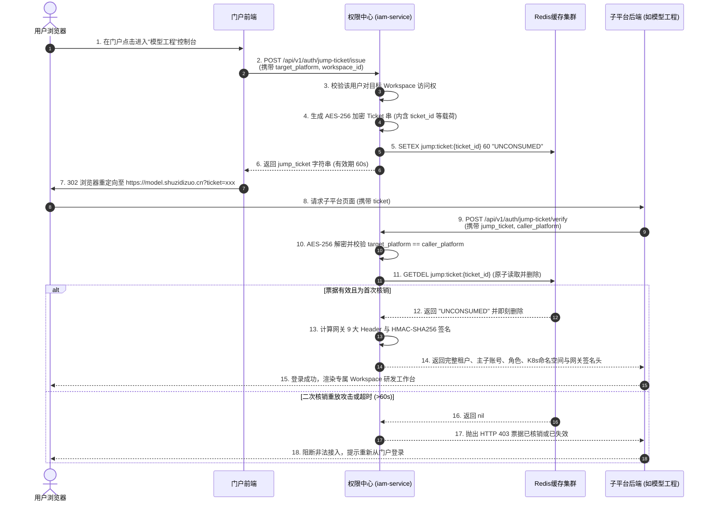

# 模块四：跨平台免密跳传与网关穿透接口规范

本文档详述从对外运营门户跳转至各底层底座平台（模型工程、算力调度、Agent 工程、信通院数据平台等）时采用的 **60 秒单次有效免密凭证（Jump Ticket）** 签发与原子核销机制，以及统一网关 **9 大可信请求头染色与 HMAC-SHA256 签名算法**。

---

## 1. 架构原理与交互时序

### 1.1 跨平台单次免密跳传全链路时序



---

## 2. 接口列表清单

| 接口名称 | HTTP Method | 接口路由 | 鉴权方式 | 说明 |
| :--- | :---: | :--- | :--- | :--- |
| **签发免密 Jump Ticket** | `POST` | `/api/v1/auth/jump-ticket/issue` | JWT (门户用户) | 校验空间权，生成 AES-256 加密 60s 单次票据 |
| **子平台单次原子核销** | `POST` | `/api/v1/auth/jump-ticket/verify`| 票据密文 | Redis GETDEL 原子核销，防重放，返回 9 大网关签名头 |

---

## 3. 接口详细定义

### 3.1 跨平台免密跳转换票签发 (`POST /api/v1/auth/jump-ticket/issue`)

#### 业务说明
当用户在门户控制台点击进入模型训练、算力控制台等子系统时，由门户后端或前端调用本接口。
- 校验当前登录用户对目标 `workspace_id` 是否拥有访问权；
- 生成 AES-256 加密密文，载荷包含全局唯一 `ticket_id`、`tenant_id`、`user_id`、`workspace_id`、`target_platform`、`issued_at`；
- 在 Redis 中写入 `SETEX jump:ticket:{ticket_id} 60 "UNCONSUMED"`，返回加密票据。

#### 请求参数
**Path & Method**: `POST /api/v1/auth/jump-ticket/issue`  
**Headers**:
- `Content-Type: application/json`
- `Authorization: Bearer <JWT_TOKEN>`

| 字段名 | 类型 | 必填 | 示例值 | 说明 |
| :--- | :--- | :---: | :--- | :--- |
| `target_platform` | `string` | 是 | `"MODEL_ENGINE"` | 目标子平台代码（如 `MODEL_ENGINE`, `COMPUTE`, `AGENT`, `CAICT_DATA_ENG`） |
| `workspace_id` | `string` | 是 | `"ws_default_p_9001"` | 用户拟进入的工作空间 ID |

#### 请求报文示例
```json
{
  "target_platform": "MODEL_ENGINE",
  "workspace_id": "ws_default_p_9001"
}
```

#### 响应报文示例
```json
{
  "code": 200,
  "message": "success",
  "data": {
    "jump_ticket": "_sQ-EIdqT8Xtoy6DPqSrI8_k4uwYWrmr6pX5iM0W18lY...",
    "expires_in": 60
  }
}
```

---

### 3.2 子平台单次原子核销票据与网关签名生成 (`POST /api/v1/auth/jump-ticket/verify`)

#### 业务说明
子平台后端收到前端传入的 `ticket` 后，立即回调本接口进行核销与置换受信任上下文。
- **解密防篡改**：使用 AES-256 解密票据，校验平台标识；
- **Redis GETDEL 原子核销**：使用 Redis `GETDEL` 指令一步完成“读取状态并立即删除键”。如果键已被读取过（或已超时 60s），直接拦截并返回 `HTTP 403 Forbidden`；
- **生成网关 9 大染色请求头**：自动根据当前账号身份生成符合规范的受信任 Header 字典（包含 HMAC-SHA256 签名）。

#### 请求参数
**Path & Method**: `POST /api/v1/auth/jump-ticket/verify`  
**Headers**:
- `Content-Type: application/json`

| 字段名 | 类型 | 必填 | 示例值 | 说明 |
| :--- | :--- | :---: | :--- | :--- |
| `jump_ticket` | `string` | 是 | `"_sQ-EIdqT8Xtoy6DPqSrI8..."` | 待核销的单次票据加密串 |
| `caller_platform`| `string` | 是 | `"MODEL_ENGINE"` | 当前发起核销的子平台代码，必须与签发时一致 |

#### 请求报文示例
```json
{
  "jump_ticket": "_sQ-EIdqT8Xtoy6DPqSrI8_k4uwYWrmr6pX5iM0W18lY...",
  "caller_platform": "MODEL_ENGINE"
}
```

#### 成功响应报文示例
```json
{
  "code": 200,
  "message": "success",
  "data": {
    "tenant_id": "ten_p_9001",
    "tenant_type": "ENTERPRISE",
    "cert_level": 2,
    "user_id": "usr_sub_422356f6",
    "master_user_id": "usr_p_9001",
    "account_type": "SUB",
    "active_workspace_id": "ws_default_p_9001",
    "roles": [
      "TENANT_DEVELOPER"
    ],
    "allowed_modules": [
      "platform:model_engine:module:*"
    ],
    "k8s_namespace": "ns-p_9001",
    "gateway_headers": {
      "X-Portal-Tenant-Id": "ten_p_9001",
      "X-Portal-User-Id": "usr_sub_422356f6",
      "X-Portal-Master-Uid": "usr_p_9001",
      "X-Portal-Workspace-Id": "ws_default_p_9001",
      "X-Portal-Role-Code": "TENANT_DEVELOPER",
      "X-Shadow-Account": "",
      "X-Gateway-Timestamp": "1794894503",
      "X-Gateway-Nonce": "hPemOCdXKh+y7rHy",
      "X-Gateway-Signature": "a69038682e2adaf2a8fd387e55689f84c9b4cca028c11ff8f896682f7332f6dd"
    }
  }
}
```

#### 二次重放攻击拦截响应示例
当黑客窃取票据尝试二次核销或重放请求时，系统立即输出标准中台异常结构：
```json
{
  "SYS_HEAD": {
    "APP_ID": "APP_SZ_PILOT_001",
    "TIMESTAMP": "2026-11-17 14:15:23 556",
    "TRANS_ID": "20261117141523555946155",
    "RESP_CODE": "A00002",
    "RESP_DESC": "票据已失效、已核销或已过期，严禁重复使用",
    "RESERVED": []
  },
  "SYS_BODY": {
    "BIZ_CODE": "403",
    "BIZ_MSG": "票据已失效、已核销或已过期，严禁重复使用"
  },
  "SYS_ATTACHED": {
    "MEDIA_INFO": ""
  },
  "code": 403,
  "message": "票据已失效、已核销或已过期，严禁重复使用",
  "detail": "票据已失效、已核销或已过期，严禁重复使用"
}
```

---

## 4. 网关防篡改签名实现参考

### HMAC-SHA256 签名生成与验证代码 (Python 3)

```python
import hmac
import hashlib

def verify_gateway_signature(headers: dict, secret: str) -> bool:
    """子平台后端检验网关签名"""
    received_sig = headers.get("X-Gateway-Signature", "")
    
    # 提取待签名头部并按 ASCII 字典排序拼接
    signed_fields = [
        "X-Portal-Tenant-Id",
        "X-Portal-User-Id",
        "X-Portal-Master-Uid",
        "X-Portal-Workspace-Id",
        "X-Portal-Role-Code",
        "X-Shadow-Account",
        "X-Gateway-Timestamp",
        "X-Gateway-Nonce",
    ]
    raw_str = "".join(f"{k}:{headers.get(k, '')}\n" for k in sorted(signed_fields))
    
    # 计算签名
    computed = hmac.new(
        secret.encode("utf-8"),
        raw_str.encode("utf-8"),
        hashlib.sha256
    ).hexdigest()
    
    return hmac.compare_digest(received_sig, computed)
```
