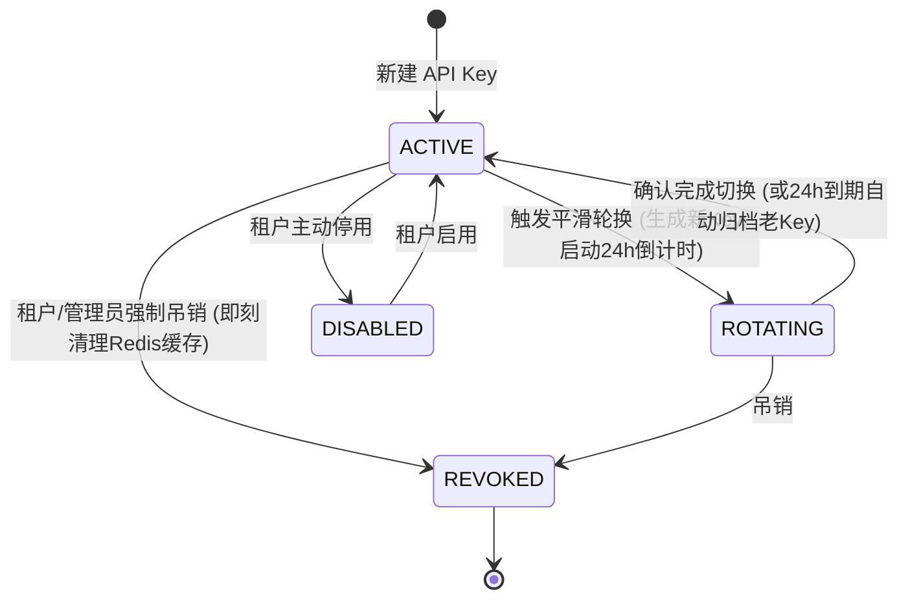

# 模块五：能力商店凭证与契约影子路由接口规范

本文档详述对外开放服务（能力商店模型推理 API、Agent 工具调用等）所采用的 **API Key 生命周期管理**、**双 Key 24 小时平滑过渡轮换**、**可信数据交易契约回调授权** 以及针对存量异构系统（如信通院数据平台）的 **影子账号（Shadow Account）JIT 路由映射** 接口规范。

---

## 1. 架构定位与安全机制

### 1.1 API Key 凭证设计与密评合规
- **双 Key 设计**：外部公开凭证前缀为 `access_key`（如 `ak-prod-9a8b7c6d`），私密密钥为 `secret_key`（如 `sk-5e4f3a2b1c...`）；
- **一次性明文展示**：`secret_key` 明文仅在创建或生成轮换密钥时于前端弹窗展示**一次**，数据库仅存储加盐哈希（`secret_key_hash`，默认采用国密 SM3 或 SHA-256 加盐 12 轮以上迭代计算）；
- **24 小时双 Key 平滑轮换**：支持租户在线申请轮换，在 24 小时过渡期（`grace_period`）内，新老两副 Key 均可正常通过鉴权，避免业务突发中断；过渡期结束后老 Key 自动失效。



### 1.2 影子账号（Shadow Account）路由机制
针对信通院数据工程等具备自身独立账号系统的存量外部系统：
- 租户在数智门户的主体为 `user_id`；
- 在通过网关进入异构系统时，由网关静默调用影子路由接口；
- 系统根据映射表（`uc_shadow_account_mapping`）自动解析出异构系统原生账号（`shadow_user_id`），若不存在则执行 **JIT（Just-In-Time）静默创号绑定**，实现跨平台无感穿透。

---

## 2. 接口列表清单

| 接口名称 | HTTP Method | 接口路由 | 适用调用方 | 说明 |
| :--- | :---: | :--- | :--- | :--- |
| **新建 API Key** | `POST` | `/api/v1/perm/apikey/create` | 租户控制台 | 生成 Access Key 与明文展示一次的 Secret Key |
| **平滑过渡轮换** | `POST` | `/api/v1/perm/apikey/rotate` | 租户控制台 | 启动 24 小时双 Key 并行轮换 |
| **吊销 API Key** | `POST` | `/api/v1/perm/apikey/revoke` | 租户控制台 | 即刻吊销凭证并清除分布式 Redis 鉴权缓存 |
| **网关高并发验权** | `POST` | `/internal/v1/perm/apikey/verify`| API 网关插件 | 校验 Key 状态、密钥摘要、IP 白名单、调用限流与订阅范围 |
| **契约回调自动授权**| `POST` | `/api/v1/perm/grant/trusted-data-callback` | 可信流通系统 | 接收数据交易订单生效事件，自动开通数据资产访问权 |
| **影子账号路由解析**| `GET` | `/internal/v1/uc/shadow-route/resolve` | API 网关插件 | 查询门户 user_id 对应的异构系统内部原生账号（JIT 懒加载） |

---

## 3. 接口详细定义

### 3.1 新建 API Key 凭证 (`POST /api/v1/perm/apikey/create`)

#### 请求参数
**Path & Method**: `POST /api/v1/perm/apikey/create`  
**Headers**:
- `Content-Type: application/json`
- `Authorization: Bearer <JWT_TOKEN>`

| 字段名 | 类型 | 必填 | 默认值 | 示例值 | 说明 |
| :--- | :--- | :---: | :---: | :--- | :--- |
| `key_name` | `string` | 是 | 无 | `"生产模型调用凭据-01"` | 凭证助记名称 |
| `allowed_scopes` | `array[string]`| 是 | 无 | `["/api/v1/models/nlp/*"]`| 允许调用的 API 资源 URI 白名单 |
| `ip_whitelist` | `string` | 否 | `""` | `"192.168.1.0/24"` | 客户端 IP 白名单 CIDR（留空表示不限制） |
| `qps_limit` | `integer`| 否 | `100` | `200` | 每秒最大调用频次 |
| `valid_days` | `integer`| 否 | `365` | `180` | 有效天数 |

#### 响应报文示例
> [!WARNING]
> `secret_key` 明文仅在创建接口响应中返回一次，后端落盘前立即加盐哈希，平台不保留明文，请提示用户妥善保存。

```json
{
  "code": 200,
  "message": "success",
  "data": {
    "key_id": "key_7a8b9c0d1e2f3a4b",
    "key_name": "生产模型调用凭据-01",
    "access_key": "ak-prod-9a8b7c6d5e4f3a2b",
    "secret_key": "sk-4e5f6a7b8c9d0e1f2a3b4c5d6e7f8a9b0c1d2e3f4a5b6c7d",
    "status": "ACTIVE",
    "allowed_scopes": [
      "/api/v1/models/nlp/*"
    ],
    "qps_limit": 200,
    "daily_call_limit": 100000,
    "expire_at": "2027-11-17T14:00:00"
  }
}
```

---

### 3.2 双 Key 24 小时平滑过渡轮换 (`POST /api/v1/perm/apikey/rotate`)

#### 业务说明
当用户怀疑 Key 泄漏或按安全制度定期换密时调用。
- 原 Key 状态变更为 `ROTATING`，记录 `grace_period_end = NOW() + 24小时`；
- 生成新的 `secret_key` 并返回明文；
- 在 24 小时内，网关验权同时支持新老两套凭证；24 小时后老 Key 自动作废。

#### 请求参数
**Path & Method**: `POST /api/v1/perm/apikey/rotate`  
**Headers**:
- `Authorization: Bearer <JWT_TOKEN>`

| 字段名 | 类型 | 必填 | 示例值 | 说明 |
| :--- | :--- | :---: | :--- | :--- |
| `key_id` | `string` | 是 | `"key_7a8b9c0d1e2f3a4b"` | 待轮换的 API Key 标识 |

#### 响应报文示例
```json
{
  "code": 200,
  "message": "success",
  "data": {
    "key_id": "key_7a8b9c0d1e2f3a4b",
    "access_key": "ak-prod-9a8b7c6d5e4f3a2b",
    "new_secret_key": "sk-new-9b8a7c6d5e4f3a2b1c...",
    "status": "ROTATING",
    "grace_period_end": "2026-11-18T14:00:00"
  }
}
```

---

### 3.3 吊销 API Key (`POST /api/v1/perm/apikey/revoke`)

#### 业务说明
立即永久废弃某副 API Key。操作完成后，服务同步清除 Redis 分布式验权缓存（`DEL apikey:cache:{access_key}`），网关在 1 毫秒内即可生效阻断调用。

#### 请求参数
**Path & Method**: `POST /api/v1/perm/apikey/revoke`  
**Headers**:
- `Authorization: Bearer <JWT_TOKEN>`

| 字段名 | 类型 | 必填 | 示例值 | 说明 |
| :--- | :--- | :---: | :--- | :--- |
| `key_id` | `string` | 是 | `"key_7a8b9c0d1e2f3a4b"` | 待吊销的凭证标识 |

#### 响应报文示例
```json
{
  "code": 200,
  "message": "success",
  "data": {
    "key_id": "key_7a8b9c0d1e2f3a4b",
    "status": "REVOKED"
  }
}
```

---

### 3.4 API 网关高并发验权专用接口 (`POST /internal/v1/perm/apikey/verify`)

#### 业务说明
供部署在流量入口的 API 网关（如 APISIX / Envoy / Kong）在拦截外部请求时发起毫秒级验证：
1. 校验 `access_key` 与签名参数；
2. 校验来源 IP 是否在白名单网段内；
3. 校验请求的 `request_path` 是否匹配 `allowed_scopes`；
4. 校验 QPS 是否超限；
5. 验证通过后返回租户 ID 及用于计费扣费的主账号 ID。

#### 请求参数
**Path & Method**: `POST /internal/v1/perm/apikey/verify`  
**Headers**:
- `Content-Type: application/json`

| 字段名 | 类型 | 必填 | 示例值 | 说明 |
| :--- | :--- | :---: | :--- | :--- |
| `access_key` | `string` | 是 | `"ak-prod-9a8b7c6d"` | 请求携带的公钥 |
| `signature` | `string` | 是 | `"c6eb4ca3daec5..."` | 客户端签名或 Secret 计算哈希 |
| `client_ip` | `string` | 是 | `"10.212.131.6"` | 客户端公网或内网 IP |
| `request_path`| `string` | 是 | `"/api/v1/models/nlp/chat"` | 当前拟请求的目标 URI |

#### 响应报文示例
```json
{
  "code": 200,
  "message": "success",
  "data": {
    "is_valid": true,
    "tenant_id": "ten_p_9001",
    "master_user_id": "usr_p_9001",
    "rate_limit_qps": 200,
    "remaining_quota": 99800
  }
}
```

---

### 3.5 可信数据流通交易契约审批完成自动授权回调 (`POST /api/v1/perm/grant/trusted-data-callback`)

#### 业务说明
当用户在“可信数据流通系统”中完成大宗政企数据购买或合约签署，且审批流程归档后，可信流通系统回调本接口。
- 写入 `perm_service_subscription_grant`；
- 写入 Casbin 策略引擎规则（`casbin_rule`）；
- 将新购买的资源 URI 自动追加到该租户有效 API Key 的 `allowed_scopes` 白名单中；
- 广播清空买方租户本地与 Redis 权限缓存。

#### 请求参数
**Path & Method**: `POST /api/v1/perm/grant/trusted-data-callback`  
**Headers**:
- `Content-Type: application/json`

| 字段名 | 类型 | 必填 | 示例值 | 说明 |
| :--- | :--- | :---: | :--- | :--- |
| `contract_id` | `string` | 是 | `"CTR_20261105_0088"` | 数据交易契约/订单编号 |
| `buyer_tenant_id` | `string` | 是 | `"ten_p_9001"` | 买方租户全局 ID |
| `resource_uri` | `string` | 是 | `"/caict/data/finance/stock_tick_v2"` | 被授权的目标资产资源 URI |
| `granted_actions` | `string` | 是 | `"READ,EXECUTE"` | 授予的操作权限动作集合 |
| `valid_from` | `string` | 是 | `"2026-11-17 00:00:00"` | 授权生效开始时间 |
| `valid_to` | `string` | 是 | `"2027-11-17 23:59:59"` | 授权失效截止时间 |

#### 响应报文示例
```json
{
  "code": 200,
  "message": "success",
  "data": {
    "grant_id": "grant_e9a8b7c6d5e4f3a2",
    "status": "EFFECTIVE",
    "contract_id": "CTR_20261105_0088",
    "synced_to_api_keys": 2
  }
}
```

---

### 3.6 存量异构平台影子账号路由解析 (`GET /internal/v1/uc/shadow-route/resolve`)

#### 业务说明
供网关在向信通院等异构存量平台转发请求时调用：
- 传入统一门户的 `user_id` 与目标异构平台代号 `target_platform_code`；
- 若已有映射则直接返回 `shadow_user_id`；
- 若无映射且配置为 JIT 模式，系统自动在底层平台创建虚拟账号并写入 `uc_shadow_account_mapping` 后返回。

#### 请求参数
**Path & Method**: `GET /internal/v1/uc/shadow-route/resolve`（亦支持 `/api/v1/internal/v1/uc/shadow-route/resolve`）  
**Query Parameters**:
| 参数名 | 类型 | 必填 | 示例值 | 说明 |
| :--- | :--- | :---: | :--- | :--- |
| `user_id` | `string` | 是 | `"usr_p_9001"` | 门户全局用户唯一标识 |
| `target_platform_code`| `string`| 是 | `"CAICT_DATA_ENG"` | 目标异构子系统代号 |

#### 响应报文示例
```json
{
  "code": 200,
  "message": "success",
  "data": {
    "shadow_user_id": "caict_native_usr_88190",
    "shadow_tenant_id": "caict_native_ten_001",
    "shadow_account_name": "zhangsan_sync",
    "mapping_type": 1,
    "sync_status": 1
  }
}
```
