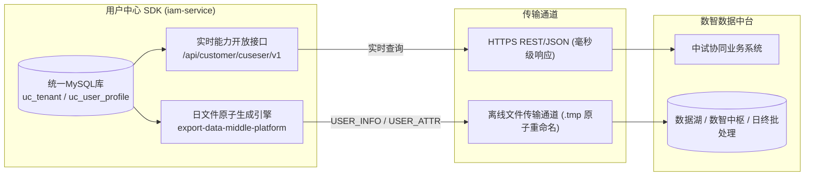
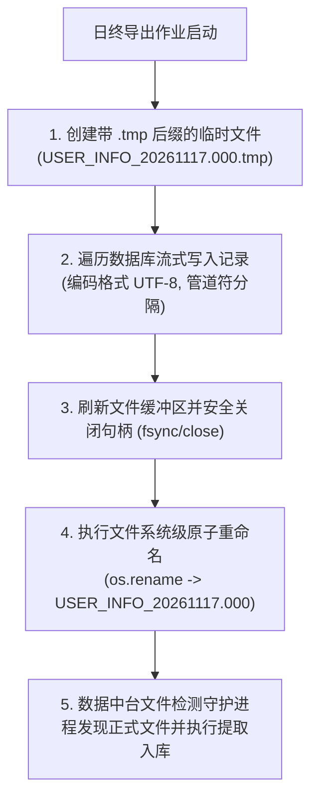

# 模块六：国家中试基地统一中台接口与离线数据文件规范

本文档详述与国家工业中试基地数智中台对接的**实时用户信息查询开放接口**以及依据《国家工业中试基地与数智中台 统一接口规范》第 3 章实施的**离线批量数据归集日文件（USER_INFO / USER_ATTR）格式与原子导出规范**。

---

## 1. 业务场景与传输机制

国家中试基地构建统一的数智底座，对数据接入采取“双模通道”：
1. **实时能力开放通道（REST/JSON）**：支持各试验中心、中试产线与外部系统实时查询用户主体信息，严格执行 2.4.3 样例报文封装；
2. **离线批量数据汇聚通道（文件传输）**：每日定时提取入驻企业、科研人员主体基础数据与多维属性，格式化为带管道符（`|`）分隔的定长/变长日终文本文件，按特定目录规划归集至数智数据中台。



---

## 2. 实时能力开放业务接口（用户信息查询）

严格对照《国家工业中试基地与数智中台 统一接口规范》2.4.3 节具象业务样例。

### 2.1 接口定义与路由映射
- **标准对外路径**：`POST /api/customer/cuseser/v1`（中台 API 网关标准路由）
- **内部兼容路径**：`POST /api/v1/customer/cuseser/v1`、`POST /api/v1/user/queryUserInfo`、`GET /api/v1/user/queryUserInfo`
- **通信机制**：REST + JSON，HTTP Header: `Content-Type: application/json; charset=UTF-8`

### 2.2 请求报文参数（SYS_BODY._QUERY_USER_INFO_REQ）

| 参数名称 | 物理类型 | 必填 | 默认值 | 示例值 | 详细业务说明 |
| :--- | :--- | :---: | :---: | :--- | :--- |
| `USER_ID` | `string` | 否 | 无 | `"usr_p_unified_1001"` | 基地入驻用户/机构全局唯一业务编号 |
| `user_id` | `string` | 否 | 无 | `"usr_p_unified_1001"` | 兼容小写字段名 |
| `portal_user_id` | `string`| 否 | 无 | `"p_unified_1001"` | 门户存量系统用户 ID |
| `QUERY_TYPE` | `string` | 否 | `"DETAIL"` | `"DETAIL"` | 查询类型（`SUMMARY` 概要 / `DETAIL` 详情） |

> [!NOTE]
> `USER_ID`、`user_id`、`portal_user_id` 三者至少提供其一。

#### 完整请求报文示例（中台标准封装）
```json
{
  "SYS_HEAD": {
    "APP_ID": "APP_SZ_PILOT_001",
    "TIMESTAMP": "2026-11-17 14:30:00 128",
    "TRANS_ID": "20261117143000128952701",
    "TOKEN": "57d603a52f7867f94a68c478e79d07ba",
    "RESERVED": []
  },
  "SYS_BODY": {
    "_QUERY_USER_INFO_REQ": {
      "USER_ID": "usr_p_unified_1001",
      "QUERY_TYPE": "DETAIL"
    }
  },
  "SYS_ATTACHED": {
    "MEDIA_INFO": ""
  }
}
```

### 2.3 响应报文参数（SYS_BODY._QUERY_USER_INFO_RSP）

| 参数名称 | 物理类型 | 必填 | 示例值 | 说明 |
| :--- | :--- | :---: | :--- | :--- |
| `BIZ_CODE` | `string` | 是 | `"0000"` | 业务层返回码：`0000` 表示查询成功 |
| `BIZ_MSG` | `string` | 是 | `"查询成功"` | 业务结果说明 |
| `USER_ID` | `string` | 是 | `"usr_p_unified_1001"` | 基地入驻用户全局唯一标识 |
| `USER_NAME` | `string` | 是 | `"苏州微纳智造先进材料研究院"` | 机构法人全称或用户姓名 |
| `PROVINCE_CODE`| `string`| 是 | `"32"` | 统一省份代码（江苏省为 `32`） |
| `EPARCHY_CODE` | `string`| 是 | `"3205"` | 统一地市代码（苏州市为 `3205`） |
| `STATUS` | `string` | 是 | `"ACTIVE"` | 账号状态（`ACTIVE` 正常 / `INACTIVE` 冻结） |

#### 完整响应报文示例
```json
{
  "SYS_HEAD": {
    "APP_ID": "APP_SZ_PILOT_001",
    "TIMESTAMP": "2026-11-17 14:30:00 256",
    "TRANS_ID": "20261117143000128952701",
    "RESP_CODE": "00000",
    "RESP_DESC": "Success",
    "RESERVED": []
  },
  "SYS_BODY": {
    "_QUERY_USER_INFO_RSP": {
      "BIZ_CODE": "0000",
      "BIZ_MSG": "查询成功",
      "USER_ID": "usr_p_unified_1001",
      "USER_NAME": "苏州微纳智造先进材料研究院",
      "PROVINCE_CODE": "32",
      "EPARCHY_CODE": "3205",
      "STATUS": "ACTIVE"
    }
  },
  "SYS_ATTACHED": {
    "MEDIA_INFO": ""
  },
  "code": 200,
  "message": "success",
  "data": {
    "BIZ_CODE": "0000",
    "BIZ_MSG": "查询成功",
    "USER_ID": "usr_p_unified_1001",
    "USER_NAME": "苏州微纳智造先进材料研究院",
    "PROVINCE_CODE": "32",
    "EPARCHY_CODE": "3205",
    "STATUS": "ACTIVE"
  }
}
```

---

## 3. 离线数据文件格式规范（规范第 3 章）

### 3.1 接口文件名命名规范
- **命名通式**：
  ```
  {业务接口名称}_{YYYYMMDD}.{分卷号}
  ```
  - `{业务接口名称}`：全大写，如 `USER_INFO`、`USER_ATTR`；
  - `{YYYYMMDD}`：生成文件的业务数据发生日期（8 位数字，如 `20261117`）；
  - `{分卷号}`：固定从 `000` 开始计数（若文件超过 500MB，依次切分为 `.001`、`.002`）。
- **示例**：
  - 用户主体日文件：`USER_INFO_20261117.000`
  - 用户属性日文件：`USER_ATTR_20261117.000`

### 3.2 字段格式规约与分隔符
- **字符集**：UTF-8 无 BOM；
- **字段分隔符**：采用半角竖线 `|` 分隔；
- **行记录分隔符**：标准换行符 `\n`（UNIX LF）；
- **行末规范**：每行最后一个字段后**不加**分隔符，直接接换行符。

---

### 3.3 数据上传明细接口

#### 3.3.1 用户信息-日文件（`USER_INFO`）
- **接口说明**：每天全量归集当前入驻基地的用户与企业组织主体信息；
- **字段规范表**：

| 序号 | 字段代码 | 物理类型 | 必填 | 规范取值 | 业务说明 |
| :---: | :--- | :--- | :---: | :--- | :--- |
| 1 | `USER_ID` | `varchar(64)` | Y | 如 `usr_p_9001` | 基地用户/机构全局唯一业务标识码 |
| 2 | `USER_NAME` | `varchar(255)`| Y | 如 `苏州数智科技有限公司` | 用户或企业组织名称 |
| 3 | `PROVINCE_CODE`| `char(2)` | Y | `32` | 统一省份代码（江苏为 `32`） |
| 4 | `EPARCHY_CODE` | `char(4)` | Y | `3205` | 统一地市代码（苏州为 `3205`） |

- **文件行内容样例**：
  ```text
  usr_p_unified_1001|苏州微纳智造先进材料研究院|32|3205
  usr_p_9001|昆山数字智能科技有限公司|32|3205
  usr_sub_422356f6|爱丽丝(算法专家)|32|3205
  ```

---

#### 3.3.2 用户属性信息-日文件（`USER_ATTR`）
- **接口说明**：按 EAV（Entity-Attribute-Value）模型归集用户的实名状态、信用代码、资质等级、账户类型等横向扩展属性；
- **字段规范表**：

| 序号 | 字段代码 | 物理类型 | 必填 | 规范取值 | 业务说明 |
| :---: | :--- | :--- | :---: | :--- | :--- |
| 1 | `USER_ID` | `varchar(64)` | Y | 如 `usr_p_9001` | 基地用户全局唯一标识 |
| 2 | `ATTR_TYPE` | `int` | Y | 1:基础/2:主体/3:行业/4:资质 | 属性所属分类代码 |
| 3 | `ATTR_NAME` | `varchar(64)` | Y | 如 `TENANT_TYPE` | 属性枚举键名 |
| 4 | `ATTR_VALUE` | `varchar(512)`| Y | 如 `ENTERPRISE` | 属性具体取值 |

- **常用属性键值映射表**：
  | ATTR_TYPE | ATTR_NAME | 典型取值 | 说明 |
  | :---: | :--- | :--- | :--- |
  | 1 | `ACCOUNT_TYPE` | `MASTER` / `SUB` | 账号主子属性 |
  | 2 | `TENANT_TYPE` | `PERSONAL` / `ENTERPRISE` | 租户类型 |
  | 2 | `CREDIT_CODE` | `91320583MA27XXXXXX` | 统一社会信用代码 |
  | 4 | `QUALIFICATION_LEVEL` | `LEVEL_0` / `LEVEL_1` / `LEVEL_2` | 对应实名等级 |

- **文件行内容样例**：
  ```text
  usr_p_unified_1001|1|ACCOUNT_TYPE|MASTER
  usr_p_unified_1001|2|TENANT_TYPE|ENTERPRISE
  usr_p_unified_1001|4|QUALIFICATION_LEVEL|LEVEL_2
  usr_p_unified_1001|2|CREDIT_CODE|91320500MABXXXXX1X
  ```

---

## 4. 离线日文件触发接口与原子性保障机制

### 4.1 数据导出触发接口 (`POST /api/v1/sync/export-data-middle-platform`)

系统内置自动化日文件导出任务接口，支持日终定时调度（Cron）触发。

- **Path & Method**: `POST /api/v1/sync/export-data-middle-platform`
- **Headers**: `Content-Type: application/json`
- **Query / Body**:
  | 参数名 | 类型 | 必填 | 默认值 | 说明 |
  | :--- | :--- | :---: | :---: | :--- |
  | `target_dir` | `string` | 否 | `upload/user` | 自定义导出本地目录路径 |

#### 响应报文示例
```json
{
  "code": 200,
  "message": "success",
  "data": {
    "status": "SUCCESS",
    "date_str": "20261117",
    "user_info_file": "USER_INFO_20261117.000",
    "user_info_count": 128,
    "user_attr_file": "USER_ATTR_20261117.000",
    "user_attr_count": 512,
    "export_directory": "D:\\昆山督导系统1\\用户中心sdk\\upload\\user"
  }
}
```

---

### 4.2 规范 3.6.3 文件上传与原子性保障机制

为了防止外部数据中台采集服务在文件尚未完全写入时提前读取导致数据半截或文件损坏，系统严格实施 **.tmp 临时文件 + 原子重命名 (Atomic Rename)** 机制：



#### 关键约束
1. 写入过程中，文件必须命名为 `{正式文件名}.tmp`；
2. 只有当全部记录成功落盘且文件句柄关闭后，才调用操作系统原子重命名 API 去除 `.tmp` 后缀；
3. 数据中台的读取程序不得轮询或提取带有 `.tmp` 扩展名的临时文件。
