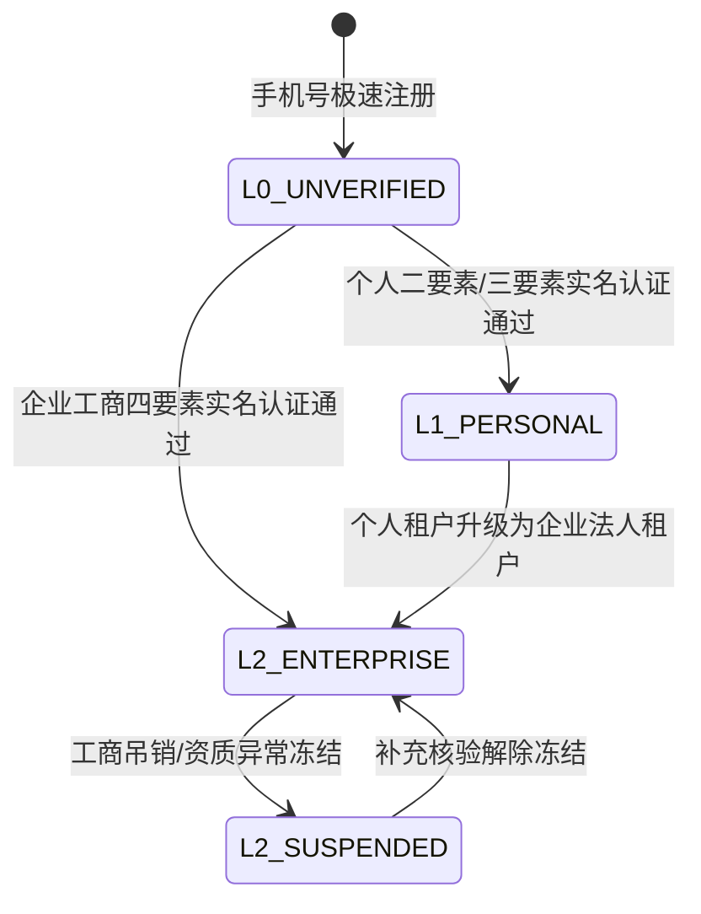

# 模块七：全局错误码对照表与标准数据字典

本文档汇编了国家工业中试基地与数智底座全域通用的**应答返回码标准（网关级与业务级）**、**7 大业务角色权限矩阵**、**租户三级实名合规状态机**及**全国中试节点区划编码字典**。

---

## 1. 系统级应答码（SYS_HEAD.RESP_CODE）

`RESP_CODE` 位于响应报文的 `SYS_HEAD` 节点中，表示平台网关层、通信层及安全认证层的处理状态。

| 应答码 (`RESP_CODE`) | HTTP 状态码 | 释义 | 详细排查指南与处置建议 |
| :--- | :---: | :--- | :--- |
| `00000` | 200 | 成功 (Success) | 平台网关层调用正常，业务已正常响应（业务结果参见 BIZ_CODE） |
| `A00001` | 400 | 参数缺失或非法 | 请求报文未按规定携带必填参数（如 APP_ID、TRANS_ID） |
| `A00002` | 403 | 访问令牌鉴权失败 | TOKEN 算法签名不匹配、APP_SECRET 错误或防重放票据已失效 |
| `A00003` | 401 | 接入标识 APP_ID 不存在 | 传入的 APP_ID 未在开放平台完成入驻登记 |
| `A00004` | 403 | IP 访问受限 | 客户端请求 IP 未在系统登记的 IP 白名单 CIDR 网段内 |
| `A00005` | 429 | 服务调用超频限流 | 客户端调用频率超出当前凭证设定的 QPS 或每日最大配额 |
| `A99997` | 422 | 报文解析与校验失败 | JSON 格式错误或未按 Pydantic 模式输入字段类型 |
| `A99998` | 504 | 底层微服务通信超时 | 业务服务处理耗时超过网关设置的 Read Timeout（15s）阈值 |
| `A99999` | 500 | 平台内部未知异常 | 网关或服务发生未捕获的系统内部崩溃，请联系管理员核对日志 |
| `C10000` | 404 | 目标资源或对象不存在 | 请求的目标用户、租户或工作空间不存在 |

---

## 2. 业务级状态码（SYS_BODY.BIZ_CODE）

`BIZ_CODE` 位于响应报文的 `SYS_BODY` 节点中，表示具体的业务逻辑校验与办理结果。

| 业务码 (`BIZ_CODE`) | 对应 HTTP | 中文业务释义 | 触发场景说明 |
| :--- | :---: | :--- | :--- |
| `0000` | 200 | 业务办理成功 | 业务逻辑执行无误 |
| `4001` | 400 | 账号用户名已被占用 | 新建子账号或同步建号时，用户名在 Casdoor 已存在 |
| `4002` | 400 | 密码复杂度不达标 | 子账号密码未满足大写字母、小写字母、数字及特殊符号组合 |
| `4003` | 400 | 缺少用户标识入参 | 查询用户信息时未提供 USER_ID 或 user_id |
| `4030` | 403 | 权限不足或角色越权 | 非管理员尝试创建子账号、分配未授权的模块白名单 |
| `4031` | 403 | 未实名认证拦截 | 个人租户尝试创建企业子账号、或未实名尝试进入大宗数据交易 |
| `4032` | 403 | 免密票据已失效 | 60 秒 Jump Ticket 已经过核销、超时或签名被篡改 |
| `4041` | 404 | 租户实体不存在 | 无法找到指定的 tenant_id |
| `4042` | 404 | 工作空间不存在 | 指定的 workspace_id 不活跃或已被释放 |
| `5001` | 500 | 安全票据存储异常 | Redis 集群连接中断或原子操作执行失败 |

---

## 3. 全网 7 大标准角色权限矩阵

数智底座将用户身份严格映射为 7 大标准角色，禁止私自增设孤立角色代码：

| 业务能力与大模块操作 | `PLATFORM_ADMIN` | `PLATFORM_OPERATOR` | `PLATFORM_DEMO` | `TENANT_ADMIN` | `TENANT_DEVELOPER` | `TENANT_FINANCE` | `TENANT_VIEWER` |
| :--- | :---: | :---: | :---: | :---: | :---: | :---: | :---: |
| **租户/主子账号管理** | 只读审计 | - | - | **读写管理** | - | - | - |
| **工作空间创建与配额** | 集群纳管 | - | **全通操作** | **读写管理** | 读 | 读 | 读 |
| **模型微调与训练任务** | - | - | **全通免扣费**| 继承管理 | **按模块放行** | - | 只读查验 |
| **Agent 沙箱编排与发布**| - | - | **全通免扣费**| 继承管理 | **按模块放行** | - | 只读查验 |
| **算力资源容器申领** | 集群纳管 | - | **全通免扣费**| 继承管理 | **按模块放行** | - | - |
| **信通院数据标注与清洗**| - | - | **全通免扣费**| 继承管理 | **按模块放行** | - | - |
| **企业实名审核与中试评审**| - | **核心审批** | - | - | - | - | - |
| **API Key 签发与轮换** | 审计 | - | **全通操作** | **核心管理** | - | - | - |
| **财务充值与话单导出** | 审计 | - | **免扣费白名单**| **核心管理** | - | **读写办理** | - |
| **看板与分析报告** | 全局看板 | 运营看板 | 演示大屏 | 租户看板 | 任务看板 | 财务对账单 | **只读查看** |

---

## 4. 租户三级实名合规状态机

三维正交身份模型下，系统依据工商与个人合规实名等级，精准界定用户行为边界：

### 字典定义表

| 等级代码 (`cert_level`) | 枚举标识符 | 租户类型 (`tenant_type`) | 功能边界与权限定义 |
| :---: | :--- | :--- | :--- |
| `0` | `L0_UNVERIFIED` | `PERSONAL` | **未实名访客**：仅限门户大厅浏览、公开服务目录查阅、公共受限沙箱免费试用；**不可充值，不可创建子账号** |
| `1` | `L1_PERSONAL_VERIFIED` | `PERSONAL` | **个人实名开发者**：支持自主充值、采购 API/模型能力、进入模型与 Agent 平台研发；**不可创建子账号，不可参与可信流通大宗交易** |
| `2` | `L2_ENTERPRISE_VERIFIED`| `ENTERPRISE` | **企业实名租户**：工商认证通过，**全面解锁企业多级子账号树派生、可信流通主体准入和大额异构算力集群申领** |

### 实名审核状态表 (`cert_status`)
- `0`: 未认证 (UNVERIFIED)
- `1`: 审核中 (PENDING)
- `2`: 已通过 (APPROVED)
- `3`: 已驳回 (REJECTED)
- `4`: 已过期 (EXPIRED)
- `5`: 已吊销 (REVOKED)

---

## 5. 行政区划与重点基地节点编码字典

依据《国家工业中试基地与数智中台 统一接口规范》3.3 节统一编码标准：

### 5.1 全国省份代码（PROVINCE_CODE，节选）
| 代码 | 省/直辖市名称 | 代码 | 省/直辖市名称 |
| :---: | :--- | :---: | :--- |
| `11` | 北京市 | `31` | 上海市 |
| `12` | 天津市 | `32` | **江苏省** |
| `13` | 河北省 | `33` | 浙江省 |
| `14` | 山西省 | `34` | 安徽省 |
| `21` | 辽宁省 | `37` | 山东省 |
| `44` | 广东省 | `50` | 重庆市 |

### 5.2 重点地市与中试基地节点代码（EPARCHY_CODE）
| 地市代码 | 地市名称 | 归属省份 | 基地节点规划说明 |
| :---: | :--- | :---: | :--- |
| `3205` | **苏州市** | 江苏省 (32) | **国家中试基地苏州中枢总部** |
| `3201` | 南京市 | 江苏省 (32) | 省级数智协同分中心 |
| `3202` | 无锡市 | 江苏省 (32) | 物联网与集成电路验证中心 |
| `3204` | 常州市 | 江苏省 (32) | 新能源装备中试验证平台 |
| `3100` | 上海市 | 上海市 (31) | 长三角创新资源共享协作节点 |
| `4403` | 深圳市 | 广东省 (44) | 粤港澳大湾区跨域协同试验区 |
