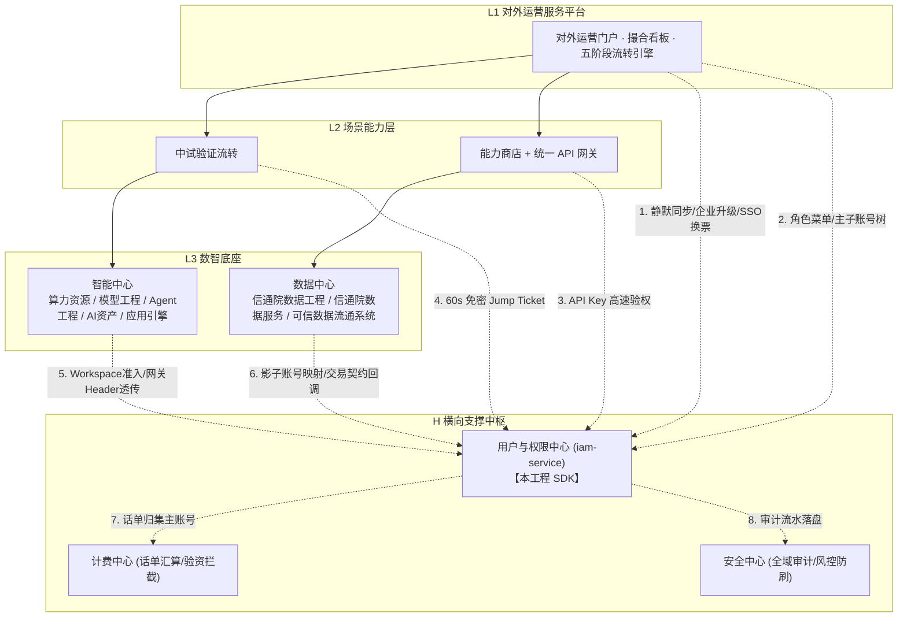

# 国家工业中试基地与数智中台 · 用户与角色权限中心统一接口规范指南

> **工程版本**：v1.0.0 (生产发布基线)  
> **服务组件**：用户中心与角色权限中心伴生服务 (`iam-service`，端口 8001)  
> **底层引擎**：Casdoor v1.x (端口 8000) + Casbin RBAC with Domains  
> **遵循规范**：
> - 《国家工业中试基地与数智中台 统一接口规范》
> - 《数智底座与运营平台：用户中心与权限中心详细设计规范》
> - 《GB/T 8567-2006 计算机软件文档编制规范》与《GB/T 39786-2021 密评三级规范》

---

## 1. 总体架构与系统定位

### 1.1 三层全景技术拓扑与中枢职能
国家工业中试基地数智中台构建集“概念验证、工艺定型、检验检测、设备共享”于一体的综合性中试验证平台。用户中心与角色权限中心贯穿全域，维系全网 11 个业务子平台、网关集群及计费、安全横向支撑中心的统一身份互通与精细化访问控制：



### 1.2 旁路增强与双模通信架构
本项目坚持“零侵入 Casdoor 底座、保持现有门户稳定、旁路增强无缝衔接”原则：
1. **统一中台报文模式**：遵循《国家中试基地统一接口规范》，请求与响应采用包含 `SYS_HEAD`（系统头）、`SYS_BODY`（业务体）、`SYS_ATTACHED`（附加信息）的标准信封包装；
2. **RESTful 平铺模式**：兼容现代前后端分离与 OpenAPI 3.0 标准平铺报文，底层由 `unified_spec_middleware` 协议中间件自动完成双向转换与流水号链路染色。

---

## 2. 全量接口清单全景矩阵

| 业务分类 | HTTP Method | 接口路由 (URL) | 接口中文名称与核心能力 | 鉴权要素 | 报文信封 (SYS_BODY) | 详述文档 |
| :--- | :---: | :--- | :--- | :--- | :--- | :--- |
| **门户同步与SSO** | `POST` | `/api/v1/sync/user` | 门户用户注册/登录静默双写同步（幂等 JIT 建档） | 中台 TOKEN / 免密 | `_PORTAL_USER_SYNC_RSP` | [02 门户同步分册](file:///d:/昆山督导系统1/用户中心sdk/doc/02_portal_sync_and_sso_apis.md) |
| **门户同步与SSO** | `POST` | `/api/v1/sync/enterprise-approved` | 门户后台企业实名认证通过回调（升级企业租户） | 中台 TOKEN / 免密 | `_ENTERPRISE_APPROVED_RSP` | [02 门户同步分册](file:///d:/昆山督导系统1/用户中心sdk/doc/02_portal_sync_and_sso_apis.md) |
| **门户同步与SSO** | `GET` | `/api/v1/sso/exchange-iframe-session`| iframe 嵌入页面免密换票与 JIT 懒加载 | `portal_token` | `data` / 平铺 | [02 门户同步分册](file:///d:/昆山督导系统1/用户中心sdk/doc/02_portal_sync_and_sso_apis.md) |
| **门户同步与SSO** | `POST` | `/api/v1/sso/sub-login` | 企业子账号登录门户兜底接口（Casdoor 验密） | 用户名 + 密码 | `_SUB_LOGIN_RSP` | [02 门户同步分册](file:///d:/昆山督导系统1/用户中心sdk/doc/02_portal_sync_and_sso_apis.md) |
| **门户同步与SSO** | `POST` | `/api/v1/sso/oauth/token` | OIDC 标准 OAuth 2.0 授权码核销与 Token 刷新 | Client Secret | 标准 OAuth JSON | [02 门户同步分册](file:///d:/昆山督导系统1/用户中心sdk/doc/02_portal_sync_and_sso_apis.md) |
| **企业主子账号树** | `POST` | `/api/v1/uc/sub-account/create` | 创建企业子账号（计算物化路径树与空间角色授权） | JWT (`TENANT_ADMIN`) | `_SUB_ACCOUNT_CREATE_RSP` | [03 主子账号分册](file:///d:/昆山督导系统1/用户中心sdk/doc/03_sub_account_apis.md) |
| **企业主子账号树** | `GET` | `/api/v1/uc/sub-account/tree` | 查询当前企业下所有主子账号列表（物化路径层级） | JWT (租户上下文) | `_SUB_ACCOUNT_ITEM_RESP_LIST_RSP` | [03 主子账号分册](file:///d:/昆山督导系统1/用户中心sdk/doc/03_sub_account_apis.md) |
| **工作空间与权限** | `POST` | `/api/v1/perm/workspace/create` | 新建租户工作空间（映射 K8s / 模型 / Agent 资源）| JWT (`TENANT_ADMIN`) | `_WORKSPACE_RESP_RSP` | [04 工作空间分册](file:///d:/昆山督导系统1/用户中心sdk/doc/04_workspace_perm_apis.md) |
| **工作空间与权限** | `GET` | `/api/v1/perm/workspace/list` | 查询当前租户工作空间列表（区分默认主空间与项目空间）| JWT (租户上下文) | `_WORKSPACE_RESP_LIST_RSP` | [04 工作空间分册](file:///d:/昆山督导系统1/用户中心sdk/doc/04_workspace_perm_apis.md) |
| **工作空间与权限** | `GET` | `/api/v1/perm/user/modules-and-roles`| 查询用户在指定空间/平台的角色与模块白名单（Redis优先）| JWT (用户上下文) | `_MODULES_AND_ROLES_RESP_RSP` | [04 工作空间分册](file:///d:/昆山督导系统1/用户中心sdk/doc/04_workspace_perm_apis.md) |
| **跨平台跳传与网关**| `POST` | `/api/v1/auth/jump-ticket/issue` | 跨平台免密跳转换票签发（60s 时效、AES-256 加密） | JWT (门户用户) | `_JUMP_TICKET_ISSUE_RSP` | [05 免密跳传分册](file:///d:/昆山督导系统1/用户中心sdk/doc/05_jump_ticket_and_gateway_apis.md) |
| **跨平台跳传与网关**| `POST` | `/api/v1/auth/jump-ticket/verify`| 子平台单次原子核销票据（Redis GETDEL、返回 9 大网关头）| 票据密文 | `_JUMP_TICKET_CONTEXT_RSP` | [05 免密跳传分册](file:///d:/昆山督导系统1/用户中心sdk/doc/05_jump_ticket_and_gateway_apis.md) |
| **能力商店凭证** | `POST` | `/api/v1/perm/apikey/create` | 新建 API Key 凭证（一次性展示 Secret Key 明文） | JWT (`TENANT_ADMIN`) | `_COMMON_RSP` | [06 凭证与契约分册](file:///d:/昆山督导系统1/用户中心sdk/doc/06_apikey_and_shadow_grant_apis.md) |
| **能力商店凭证** | `POST` | `/api/v1/perm/apikey/rotate` | 双 Key 24 小时平滑过渡轮换 | JWT (`TENANT_ADMIN`) | `_COMMON_RSP` | [06 凭证与契约分册](file:///d:/昆山督导系统1/用户中心sdk/doc/06_apikey_and_shadow_grant_apis.md) |
| **能力商店凭证** | `POST` | `/api/v1/perm/apikey/revoke` | 即刻吊销 API Key 并清除 Redis 分布式验权缓存 | JWT (`TENANT_ADMIN`) | `_COMMON_RSP` | [06 凭证与契约分册](file:///d:/昆山督导系统1/用户中心sdk/doc/06_apikey_and_shadow_grant_apis.md) |
| **能力商店凭证** | `POST` | `/internal/v1/perm/apikey/verify`| 能力商店 API 网关高并发验权（IP、QPS、Scope校验） | Access Key + 签名 | `data` / 平铺 | [06 凭证与契约分册](file:///d:/昆山督导系统1/用户中心sdk/doc/06_apikey_and_shadow_grant_apis.md) |
| **契约与影子路由** | `POST` | `/api/v1/perm/grant/trusted-data-callback` | 可信数据流通交易契约回调自动授权 | 系统互信 Token | `_COMMON_RSP` | [06 凭证与契约分册](file:///d:/昆山督导系统1/用户中心sdk/doc/06_apikey_and_shadow_grant_apis.md) |
| **契约与影子路由** | `GET` | `/internal/v1/uc/shadow-route/resolve` | 存量异构平台影子账号查询与 JIT 映射路由 | 内部网关调用 | `_COMMON_RSP` | [06 凭证与契约分册](file:///d:/昆山督导系统1/用户中心sdk/doc/06_apikey_and_shadow_grant_apis.md) |
| **中试中台标准业务**| `POST` | `/api/customer/cuseser/v1` | 数智中台标准用户信息查询（规范 2.4.3 具象示例） | 中台 TOKEN / 传参 | `_QUERY_USER_INFO_RSP` | [07 数据中台分册](file:///d:/昆山督导系统1/用户中心sdk/doc/07_data_middle_platform_file_spec.md) |
| **中试中台标准业务**| `POST` | `/api/v1/sync/export-data-middle-platform` | 数据中台日文件导出（USER_INFO / USER_ATTR 原子落盘）| 定时作业 / 管理员 | `_EXPORT_DATA_MIDDLE_PLATFORM_RSP` | [07 数据中台分册](file:///d:/昆山督导系统1/用户中心sdk/doc/07_data_middle_platform_file_spec.md) |
| **系统运维与托管** | `GET` | `/health` | 服务探活健康检查接口 | 无 | `{"status": "healthy"}` | 本文第 4 节 |
| **系统运维与托管** | `GET` | `/ui/{path}` | 嵌入前端 SPA 静态托管路由 | 无 | HTML / 静态资源 | 本文第 4 节 |

---

## 3. 标准化分册文档导航索引

整个标准化文档体系分为 8 个专业分卷，开发者可按需查阅：

1. **[01 通信协议、报文封装与认证鉴权规范](file:///d:/昆山督导系统1/用户中心sdk/doc/01_protocol_and_auth_spec.md)**  
   规定 REST/JSON 通信机制、中台 `SYS_HEAD` 协议信封、中台 TOKEN 算法（MD5 字典升序）、内部 JWT Claims 格式、统一网关 9 大 Header 染色与 HMAC-SHA256 签名算法。
2. **[02 门户同步与单点登录（SSO）接口规范](file:///d:/昆山督导系统1/用户中心sdk/doc/02_portal_sync_and_sso_apis.md)**  
   详述存量门户注册/登录静默双写同步（幂等性）、企业认证通过回调、iframe 前端换票及企业子账号登录门户兜底接口。
3. **[03 企业主子账号树管理接口规范](file:///d:/昆山督导系统1/用户中心sdk/doc/03_sub_account_apis.md)**  
   详述物化路径（Materialized Path）设计原理、企业多级子账号创建与层级拓扑树状结构查询接口。
4. **[04 工作空间与角色权限接口规范](file:///d:/昆山督导系统1/用户中心sdk/doc/04_workspace_perm_apis.md)**  
   详述租户工作空间（Workspace）生命周期管理、底层底座映射（K8s Namespace 等）以及 7 大标准角色与大模块白名单裁剪（Redis 优先缓存）。
5. **[05 跨平台免密跳传与网关穿透接口规范](file:///d:/昆山督导系统1/用户中心sdk/doc/05_jump_ticket_and_gateway_apis.md)**  
   详述 60 秒时效 AES-256 加密 Jump Ticket 签发与基于 Redis `GETDEL` 指令的单次原子核销防重放机制。
6. **[06 能力商店凭证与契约影子路由接口规范](file:///d:/昆山督导系统1/用户中心sdk/doc/06_apikey_and_shadow_grant_apis.md)**  
   详述能力商店 API Key 签发、24 小时双 Key 平滑过渡轮换、可信流通交易契约审批回调及存量系统影子账号 JIT 映射机制。
7. **[07 国家中试基地统一中台接口与离线数据文件规范](file:///d:/昆山督导系统1/用户中心sdk/doc/07_data_middle_platform_file_spec.md)**  
   详述标准用户信息查询业务样例（2.4.3），以及规范第 3 章离线日数据文件（`USER_INFO`、`USER_ATTR`）格式与 `.tmp` 原子重命名落盘保障。
8. **[08 全局错误码对照表与标准数据字典](file:///d:/昆山督导系统1/用户中心sdk/doc/08_error_codes_and_dictionary.md)**  
   汇编国家中试基地标准系统返回码（`RESP_CODE`）、业务返回码（`BIZ_CODE`）、7 大标准角色权限矩阵、租户三级实名状态机与全国中试省市字典。

---

## 4. 快速接入与工程联调指引（Quickstart）

### 4.1 本地开发与容器部署
服务支持在纯命令行或容器编排环境中启动：

```powershell
# 1. 查看环境变量配置（复制模板）
Copy-Item .env.example .env

# 2. 一键启动容器栈（Casdoor + MySQL + Redis + iam-service）
docker compose up -d

# 3. 检查服务健康状态
curl http://127.0.0.1:8001/health
```

### 4.2 交互式 Swagger 与 Redoc 在线文档
服务内置符合 OpenAPI 3.0 标准的交互式测试控制台：
- **Swagger UI 交互调试页**：`http://{host}:8001/docs`
- **ReDoc 离线查阅文档页**：`http://{host}:8001/redoc`
- **OpenAPI 原生 JSON 描述**：`http://{host}:8001/openapi.json`

### 4.3 全链路自动化测试命令
系统内置完整的自动化测试流水线，支持一键自检与合规性验收：

```powershell
# 运行国家中试基地与数智中台统一接口规范深度测试（验证 2.2 Token、2.4 报文与第 3 章文件导出）
python scripts/test_unified_spec.py

# 运行用户与权限中心全链路命令行验收测试（涵盖 11 个业务断言：同步、子账号树、空间、Jump Ticket 防重放、网关签名）
python scripts/test_cli.py
```

### 4.4 极速对接代码示例（Python 3 / cURL）

#### cURL 调用示例（标准中台报文模式）
```bash
curl -X POST "http://127.0.0.1:8001/api/v1/sync/user" \
  -H "Content-Type: application/json; charset=UTF-8" \
  -d '{
    "SYS_HEAD": {
      "APP_ID": "APP_SZ_PILOT_001",
      "TIMESTAMP": "2026-11-17 14:00:00 128",
      "TRANS_ID": "20261117140000128000111",
      "TOKEN": "57d603a52f7867f94a68c478e79d07ba",
      "RESERVED": []
    },
    "SYS_BODY": {
      "_SYNC_USER_REQ": {
        "PORTAL_USER_ID": "p_9001",
        "USERNAME": "zhangsan_ceo",
        "DISPLAY_NAME": "张三",
        "IS_ENTERPRISE": true,
        "COMPANY_NAME": "昆山数字智能科技有限公司"
      }
    },
    "SYS_ATTACHED": {
      "MEDIA_INFO": ""
    }
  }'
```

#### Python SDK 调用示例
```python
import httpx
import hashlib
from datetime import datetime

def call_sync_user(base_url: str, app_id: str, app_secret: str, user_info: dict):
    now_str = datetime.now().strftime("%Y-%m-%d %H:%M:%S") + " 100"
    trans_id = datetime.now().strftime("%Y%m%d%H%M%S") + "100999888"
    
    # 1. 计算中台规范 2.2 TOKEN
    raw = f"APP_ID{app_id}TIMESTAMP{now_str}TRANS_ID{trans_id}{app_secret}"
    token = hashlib.md5(raw.encode("utf-8")).hexdigest().lower()
    
    payload = {
        "SYS_HEAD": {
            "APP_ID": app_id,
            "TIMESTAMP": now_str,
            "TRANS_ID": trans_id,
            "TOKEN": token,
            "RESERVED": []
        },
        "SYS_BODY": {
            "_SYNC_USER_REQ": user_info
        },
        "SYS_ATTACHED": {"MEDIA_INFO": ""}
    }
    
    with httpx.Client(timeout=10.0) as client:
        resp = client.post(f"{base_url}/api/v1/sync/user", json=payload)
        return resp.json()
```

---

## 5. 版本历史与演进规范

| 版本号 | 发布日期 | 责任团队 | 主要变更内容与交付里程碑 |
| :---: | :---: | :---: | :--- |
| `v1.0.0` | 2026-11-17 | 数智底座中枢研发攻坚组 | **生产封板基线**：完成国家中试基地规范对齐、双模通信中间件、门户同步与SSO、企业主子账号物化路径树、工作空间管理、60s 单次原子核销 Jump Ticket、网关 9 大 Header 染色与 HMAC 签名、离线日文件原子导出全量功能。 |
